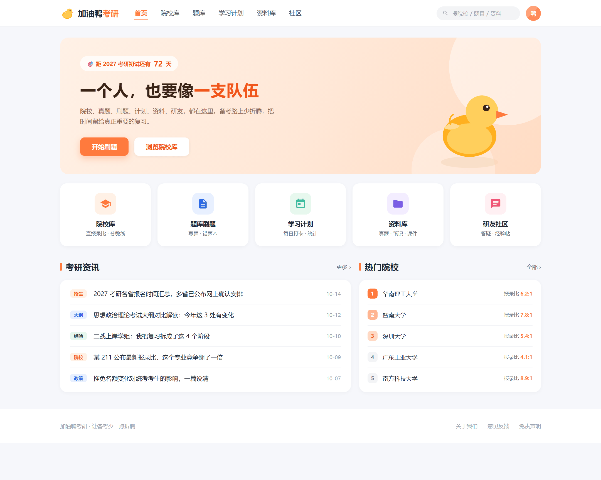

# 加油鸭考研平台

「加油鸭」是「加油呀」的谐音，当年挺火的一个梗。拿来当项目名顺口，也图个吉利。

做它的起点很简单，身边有人在考研。

我看了他们一阵子，发现最累的其实不是学，是找。招生简章在一个网站，历年真题在另一个网站，刷题要开个 App，做学习计划又得开备忘录，遇到不会的题还得去贴吧或者群里问一圈。信息碎在七八个地方，光来回倒腾就耗掉不少精力，更别说每个平台都得注册一次。

所以我就想，能不能把这些捏到一块，查院校、刷题、做计划、传资料、讨论问题，一个网站全搞定。目标不大，就是想让备考的人少打开几个 App。

先看看它长什么样：

## 后端用 SpringBoot，主要是偷懒

技术栈没什么好纠结的，前端 Vue、后端 SpringBoot、数据库 MySQL，教科书上最常见的那一套。

选 Vue 是因为上手快，组件生态全，这项目里全是列表、表单、卡片，用组件拼起来很省事。SpringBoot 是看中它开箱即用，路由、参数校验、数据库操作、安全认证这些标配的活它都给你配好了，不用自己从头搭。还有一个不太上台面的理由，Java 这套资料多，我遇到问题搜一下基本都有答案，写起来心里有底。MySQL 就更不用说了，本科课程里最熟的就是它。

前后端分离的好处是能并行，前端先拿接口文档把页面写出来，用 mock 数据顶着，不用干等后端。坏处也很实在，跨域。这个东西后面单独说，它是这套架构绕不过去的第一个坎。

## 判题那块，我写错过两次

平台一共五块，院校信息、题库刷题、学习计划打卡、资料分享、社区论坛。全做完不现实，说几个我真正花时间琢磨的。

院校库和学习计划打卡比较轻，前者是筛选加列表，后者是日历加任务清单，没什么好讲的：

题库的重点其实不在出题，在数据怎么存。一道题有题干、选项、答案、解析，而单选、多选、判断的选项数量还不一样。我最后把题型抽成一个字段，选项统一存成 JSON 数组，答案存正确选项的标识，这样以后加新题型不用动表结构。

判题逻辑里多选题最烦，用户选的集合必须跟正确答案完全相等，多选一个、漏选一个都算错。我一开始用 `includes` 一个一个判断，写成了一坨 if 套 if，自己看着都头疼。后来改成把两个集合排个序、转成字符串直接比对，一下就清爽了，虽然这写法谈不上优雅，但它好懂。

错题本是我自己觉得最实用的一个功能，答错的题自动进去，能单独刷第二遍。这里用了一张 `user_wrong` 关联表记「谁错了哪道题」，没往题目表上挂字段。当时犹豫过，挂字段省事，但一道题错的人多了就没地方放了。

刷题页右边那张答题卡是照着考试的感觉做的，对错一眼能看出来：

## 上传文件，比写页面麻烦多了

资料分享是让用户传真题、笔记、PDF，别人能下。文件这个东西看着简单，一碰全是细节。

第一个是大小限制。multipart 默认上限很小，传个大点的 PDF 直接给你 413，得去配置里放开。第二个是文件存哪。存服务器本地最简单，但数据库记录和物理文件特别容易对不上，删了记录文件还在，删了文件记录还挂着，磁盘越跑越满。我最后是文件存本地、数据库只存路径，删除走逻辑删除，物理文件定期清。

社区论坛那块是帖子、评论、点赞。评论如果要支持楼中楼，本质是个树形结构，要么存 `parent_id` 递归查，要么存路径。我选了 `parent_id`，后端返回扁平列表，前端自己拼成树。

点赞有个小设计，一个人对一条帖子只能点一次。我没写「先查有没有点过、再决定插不插」，那样中间隔着一次请求，连点两下照样能插进去两条。我在「用户ID + 帖子ID」上建了联合唯一索引，重复插入数据库直接报错，靠它自己就把重复挡住了。

## 跨域，开发环境和线上是两码事

跨域是前后端分离的必经之路。开发的时候前端跑在 5173，后端跑在 8080，浏览器一看端口不一样就判定跨域，接口直接被拦，控制台红一片。

开发环境好解决，Vite 配个 `proxy`，把 `/api` 开头的请求转发给后端，浏览器就以为是同源了。我当时以为配完就完事了，结果一部署到线上又懵了——前端打包成静态文件放进 Nginx，后端还是独立端口，跨域原封不动地回来了。

线上要么让 Nginx 反向代理后端，前端还是请求 `/api`，Nginx 转给后端，对外保持同域；要么后端老老实实配 CORS。

我真正踩的坑在预检请求上。普通请求没事，可一旦带上自定义请求头，比如把 token 放在 `Authorization` 里，浏览器就把它当成复杂请求，先发一个 `OPTIONS` 探路。后端没处理 `OPTIONS`，直接 403，真正的请求压根没发出去。我在那儿对着「接口 403」查了很久，一直在怀疑 token 写错了、拦截器配错了，最后才发现问题根本不在 POST 上，在它前面那个看不见的 OPTIONS。

## 部署那天，本地能跑的东西全废了

从本地跑通到线上跑通，中间隔着一堆本地永远不会出现的问题。

前端 `vue build` 出来是 dist 目录，扔进 Nginx 的网站目录就行。但我第一次部署，刷新页面就 404。原因是 Vue 是单页应用，路由由前端管，用户直接访问 `/school/123` 这种路径，Nginx 会老老实实去找这个文件，当然找不到。得配 `try_files`，把找不到的路径统一兜回 `index.html`，交给前端路由去解析。

后端打成 jar，`java -jar` 就能起。坑在配置。数据库连接地址、上传目录这些，本地和服务器不一样，得用不同 profile 或者环境变量分开，不能硬编码。我第一次就是把本地配置原样传上去，数据库直接连不上，报错还只给半截，对着日志一行行查才找到。

还有个细节，上传文件的目录在服务器上最好用绝对路径，或者固定在 jar 同级的某个位置。不然重启之后进程的工作目录变了，之前传的文件会像凭空消失一样。

## 代码在这

这个平台的界面原型（可交互）已经开源，可以直接在浏览器里点着玩：

👉 [GitHub - jiayouya-kaoyan-platform](https://github.com/freedom-thinking/jiayouya-kaoyan-platform)

「加油鸭」后来没再维护了。但那段跟部署死磕的日子，比写业务代码记得清楚多了，尤其是有天凌晨终于刷出来一个不再 404 的页面，我截了张图，虽然那个页面其实什么内容都没有。
