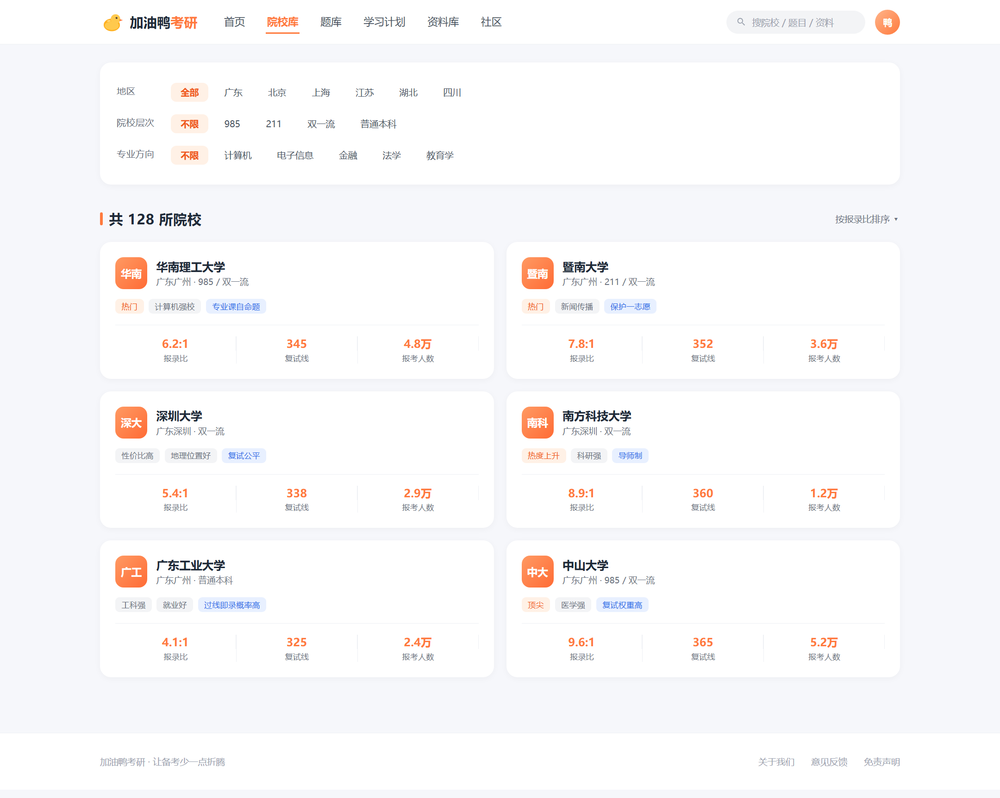
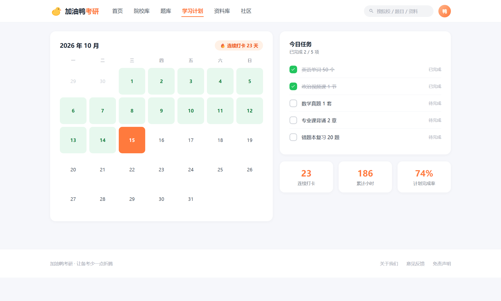
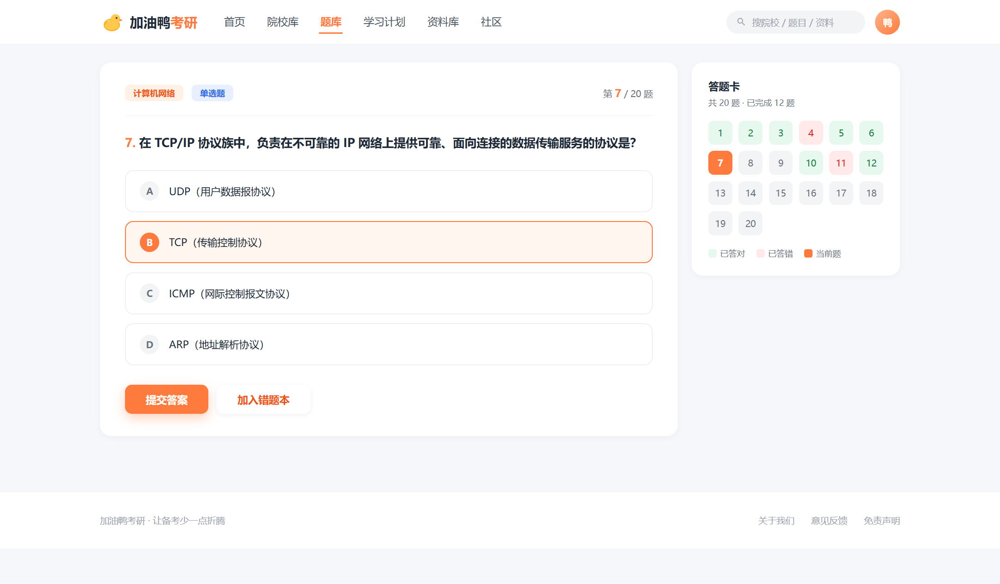
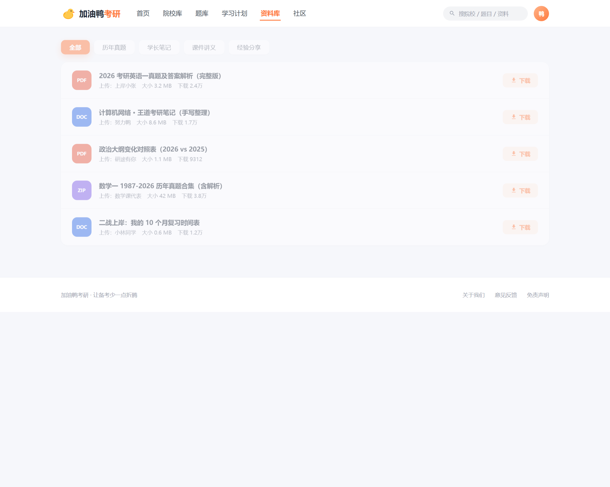
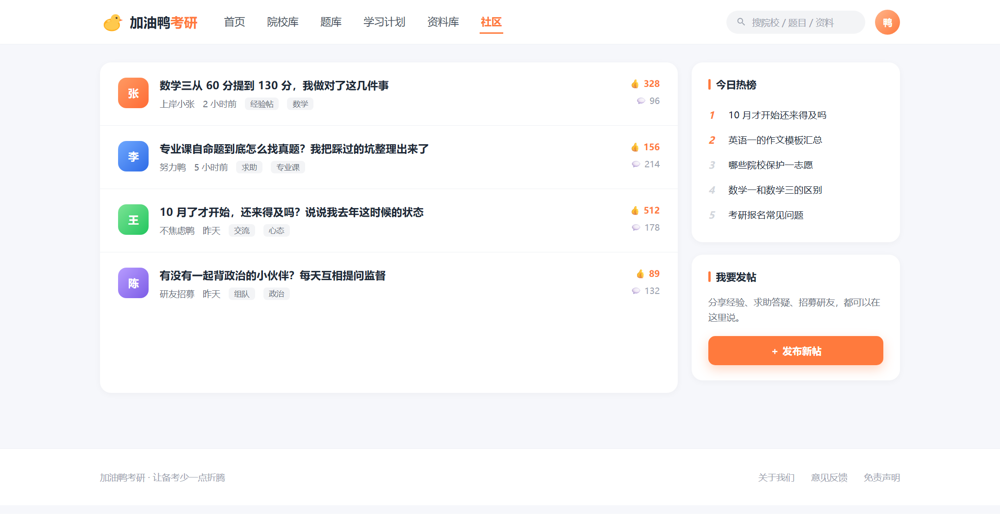

# 加油鸭考研平台

「加油鸭」取自「加油呀」的谐音，作为项目名称便于记忆。项目的出发点是身边有同学在备考研究生。

备考过程中消耗精力最多的并非学习本身，而是信息检索：招生简章在一个网站，历年真题在另一个网站，刷题需要单独的应用，学习计划依赖备忘录，遇到问题还需在论坛或群组中询问。信息分散在多个平台，切换成本较高，且每个平台均需单独注册。

## 一、项目概述

- **形态**：Web 平台，前后端分离架构
- **场景**：整合院校查询、刷题、学习计划、资料上传与讨论，减少备考过程中需要打开的应用数量
- **技术栈**：Vue · Spring Boot · MySQL

## 二、技术选型

前端 Vue，后端 Spring Boot，数据库 MySQL。

选择 Vue 的原因是上手成本低、组件生态完整，本项目以列表、表单、卡片为主，通过组件组合即可完成。选择 Spring Boot 是因其开箱即用的特性：路由、参数校验、数据库操作、安全认证等常规能力均已提供，无需自行搭建。同时 Java 生态的资料较为充分，遇到问题的可检索性较高。MySQL 则是本科阶段使用最多的数据库。

前后端分离的优点是前后端可并行开发：前端依据接口文档先行完成页面，使用 mock 数据支撑，无需等待后端。代价是跨域问题，这是该架构中首先需要处理的环节，后文单独说明。

## 三、功能模块

平台共五个模块：院校信息、题库刷题、学习计划打卡、资料分享、社区论坛。以下说明其中投入较多的部分。

院校库与学习计划打卡的实现成本较低，前者为筛选与列表，后者为日历与任务清单：

题库的重点不在出题，而在数据结构。一道题目包含题干、选项、答案与解析，且单选题、多选题、判断题的选项数量不一致。最终将题型抽为独立字段，选项统一存储为 JSON 数组，答案存储正确选项的标识，从而在新增题型时无需修改表结构。

判题逻辑中多选题最为复杂：用户选择的集合必须与正确答案完全相等，多选或漏选均判为错误。初期采用 `includes` 逐个判断，形成多层条件嵌套，可读性较差。后续改为将两个集合排序后转为字符串直接比对，实现更为简洁。

错题本是实用性最高的功能：答错的题目自动记录，可单独进行第二轮练习。实现上使用 `user_wrong` 关联表记录「哪个用户错了哪道题」，未在题目表上增加字段。原因是题目表挂字段的方案虽简单，但同一道题被多人答错时无法记录。

刷题页右侧的答题卡依照考试场景设计，对错状态可直接辨认：

## 四、文件上传

资料分享允许用户上传真题、笔记与 PDF，供他人下载。文件处理涉及较多细节。

一是大小限制。multipart 默认上限较小，上传较大的 PDF 会直接返回 413，需在配置中调整。二是存储位置。存放在服务器本地最简单，但数据库记录与物理文件容易不一致：删除记录后文件残留，删除文件后记录仍指向空路径，磁盘占用持续增长。最终方案为文件存本地、数据库仅存路径，删除采用逻辑删除，物理文件定期清理。

社区论坛包含帖子、评论与点赞。评论如需支持楼中楼，本质是树形结构，可选方案为存储 `parent_id` 递归查询，或存储路径。本项目选择 `parent_id`，后端返回扁平列表，由前端组装为树。

点赞有一项约束：同一用户对同一帖子只能点赞一次。未采用「先查询是否已点赞、再决定是否插入」的方式，因为两次操作之间存在时间间隔，连续点击仍可能插入两条记录。实现上在「用户 ID + 帖子 ID」上建立联合唯一索引，重复插入由数据库直接拒绝。

## 五、跨域处理

跨域是前后端分离架构的必经环节。开发环境下前端运行于 5173 端口，后端运行于 8080 端口，浏览器判定为跨域并拦截请求。

开发环境的处理方式是配置 Vite 的 `proxy`，将 `/api` 开头的请求转发至后端，浏览器视为同源。该配置仅作用于开发环境：部署到线上后，前端以静态文件形式置于 Nginx，后端仍为独立端口，跨域问题重新出现。

线上环境的方案有两种：由 Nginx 反向代理后端，前端仍请求 `/api`，对外保持同域；或由后端配置 CORS。

实际遇到的问题出在预检请求上。普通请求可正常通过，但携带自定义请求头（例如将 token 放入 `Authorization`）时，浏览器会将其视为复杂请求，先发送 `OPTIONS` 请求探测。后端未处理 `OPTIONS` 时直接返回 403，实际请求未能发出。排查时曾怀疑 token 或拦截器配置有误，最终确认问题在于 `POST` 之前的 `OPTIONS` 请求未被处理。

## 六、部署

从本地运行到线上可用，涉及若干本地环境中不会出现的问题。

前端执行 `vue build` 后生成 dist 目录，置于 Nginx 网站目录即可。首次部署时刷新页面返回 404，原因是单页应用的路由由前端管理，用户直接访问 `/school/123` 时，Nginx 会按路径查找文件。需配置 `try_files`，将未匹配的路径统一指向 `index.html`，交由前端路由解析。

后端打包为 jar，通过 `java -jar` 启动，问题集中在配置：数据库连接地址、上传目录等在本地与服务器上不同，需通过不同 profile 或环境变量区分，不可硬编码。首次部署时直接使用本地配置，导致数据库连接失败，且报错信息不完整，需逐行查看日志定位。

另一个细节是上传目录：服务器上应使用绝对路径，或固定于 jar 同级的指定位置。否则进程重启后工作目录变化，此前上传的文件将无法访问。

## 七、现状与源码

「加油鸭」后续未再维护。部署阶段的排查经历比业务代码的编写过程更具参考价值，其中涉及的问题在本地开发环境中均不会出现。

平台界面原型（可交互）已开源，可直接在浏览器中操作：

👉 [GitHub - jiayouya-kaoyan-platform](https://github.com/freedom-thinking/jiayouya-kaoyan-platform)
