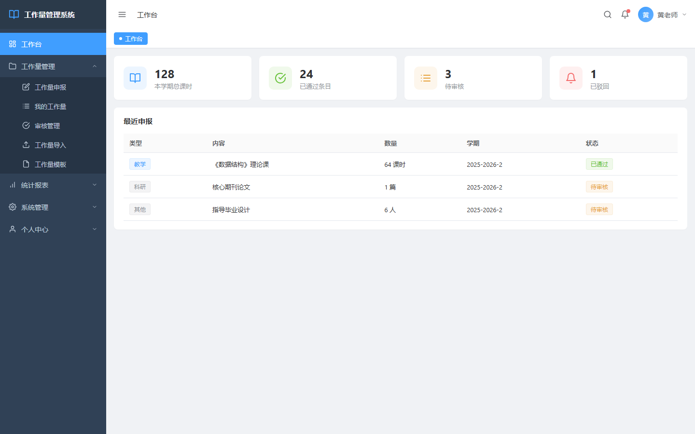
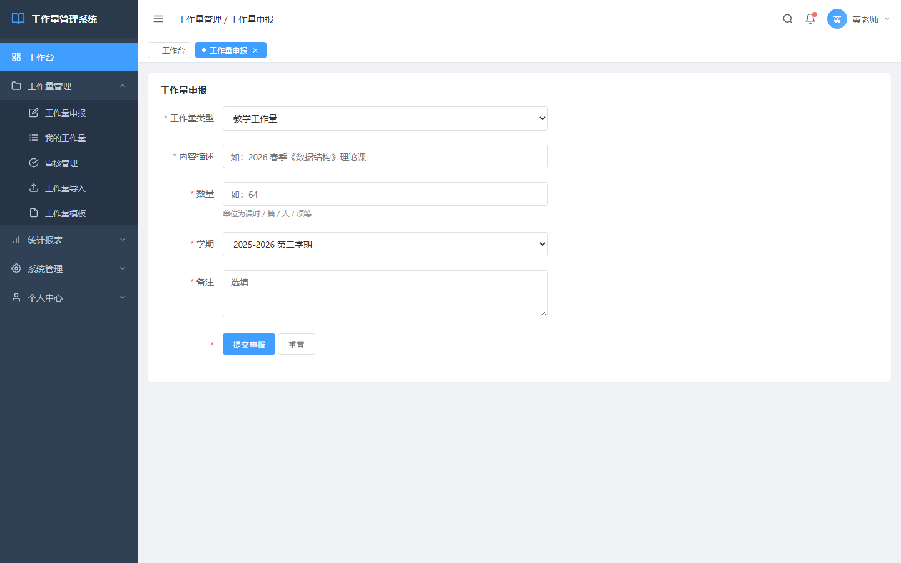
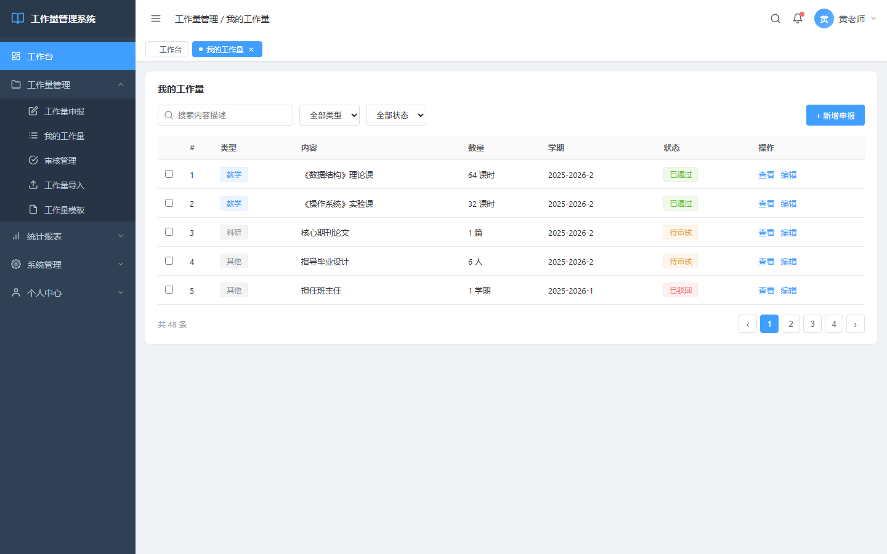
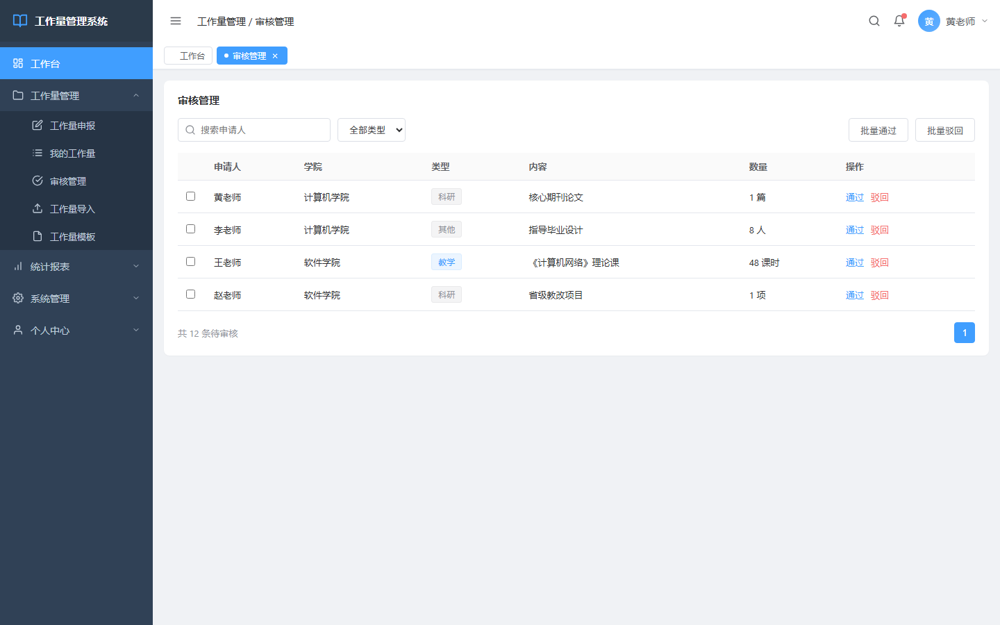
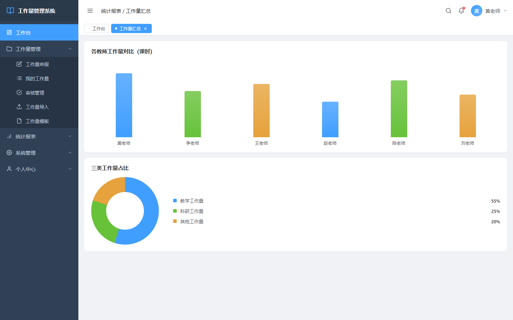

# 教师工作量管理系统

本系统用于统计教师在一个学期内的工作量。

教师每学期需要记录的内容较为分散：授课课时、带班数量、发表论文、指导学生、班主任任职等。此前这些数据依赖手工填表，再以 Excel 汇总，学期末统计时容易出现记录遗漏与数据不一致，需要逐一电话核对。本系统的目标是将申报、审核、统计三个环节迁移至线上。

## 一、项目概述

- **形态**：Web 后台管理系统，前后端分离架构
- **场景**：教师学期工作量的申报、审核与统计
- **技术栈**：Vue 3 + Element Plus（前端）· Spring Boot（后端）
- **分工**：本人承担前端开发与接口对接

## 二、界面构成

登录页采用左右分栏布局，左侧为校园风格背景图，右侧为账号密码表单，支持记住密码。


工作台为教师登录后的首页，顶部显示总课时、已通过申报、待审核、被驳回四项指标，下方为最近的申报动态。该页面的作用是在进入系统时即可了解本学期的工作量进度与待处理事项。



申报页是系统中字段最多的表单，包含类型、描述、数量、学期、备注等字段，并配有完整校验规则。



我的工作量页为列表视图，支持按类型与状态筛选，带分页，每条记录可查看、编辑、删除。



审核管理页为管理员视角，对待审核记录逐条处理，可执行通过或驳回操作；驳回时须填写原因，否则申报人无法定位问题。



统计报表页包含柱状图与饼图，分别用于展示各教师工作量对比与教学、科研、其他三类占比。



## 三、表单实现

技术选型上，采用 Vue 3 组合式 API，将同一功能的逻辑集中组织，避免 Vue 2 选项式 API 下 data、methods、computed 分散的问题。Element Plus 作为 ElementUI 的 Vue 3 版本，提供了表格、表单、弹窗、下拉框、日期选择等后台常用组件，减少了样式与交互的自定义工作量。

实际开发中，后台系统的主要时间成本不在功能数量，而在表单。

申报页字段较多，每个字段均需配置校验规则：类型必选，数量须为大于零的数字，学期不可为空。Element Plus 的 `el-form` 内置 `rules` 机制，但字段增多后容易出现配置与属性名不一致、校验不触发、已填写仍提示「请输入」等问题。此类问题不产生报错，仅表现为校验失效，只能逐行核对。

```vue
<el-form :model="form" :rules="rules" ref="formRef">
  <el-form-item label="工作量类型" prop="type">
    <el-select v-model="form.type">
      <el-option label="教学" value="teaching" />
      <el-option label="科研" value="research" />
      <el-option label="其他" value="other" />
    </el-select>
  </el-form-item>
  <el-form-item label="数量" prop="amount">
    <el-input v-model.number="form.amount" />
  </el-form-item>
</el-form>
```

列表页的实现成本明显较低：`el-table` 配合分页与筛选条件即可完成，组件均为现成能力。

## 四、三个实现问题

**响应式 API 的区分。** `ref` 与 `reactive` 在使用初期容易混淆。`ref` 包装对象后若遗漏 `.value`，数据修改不会反映到视图；`reactive` 对象在解构后响应式失效，页面始终显示首次渲染的值。最终的约定是：基本类型使用 `ref`，对象使用 `reactive`，两者不混用。

**跨域。** 前端运行于 5173 端口，后端运行于 8080 端口，首次联调时浏览器即报 CORS 错误。开发环境通过配置代理转发解决；排查初期曾误判为接口地址填写错误，反复检查 controller 后方才定位。

**token 过期处理。** 登录获取的 token 具有有效期，过期后接口返回 401。若未在响应拦截器中统一处理，用户在填写表单过程中会被跳转至未登录状态，已填内容丢失。后续在拦截器中增加 401 处理：清除本地 token 并跳回登录页。

```js
service.interceptors.response.use(
  res => res,
  err => {
    if (err.response?.status === 401) {
      localStorage.removeItem('token')
      router.push('/login')
    }
    return Promise.reject(err)
  }
)
```

## 五、现状

后台系统的实现门槛不高，组件组合即可完成主要页面。但响应式、组件通信、请求拦截等不直接可见的部分，需要通过实际项目才能建立判断，例如同一页面在不同实现水平下的可维护性差异。

当前版本的不足在于：界面尚未经过真实用户使用，交互设计依据的是对教师操作路径的推演，未获得实际反馈。

项目源码已开源：

👉 [GitHub - 教师工作量管理系统](https://github.com/freedom-thinking/workload-management-system)
