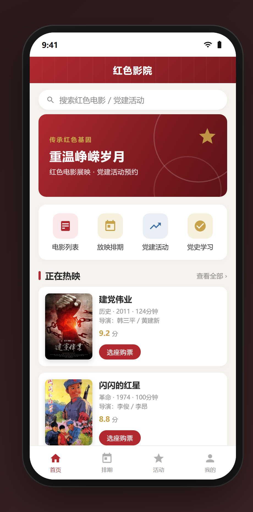
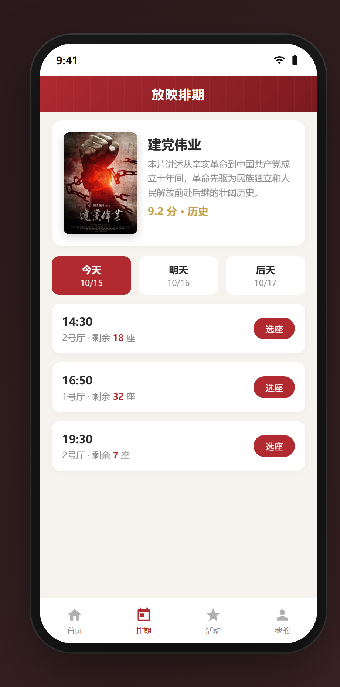
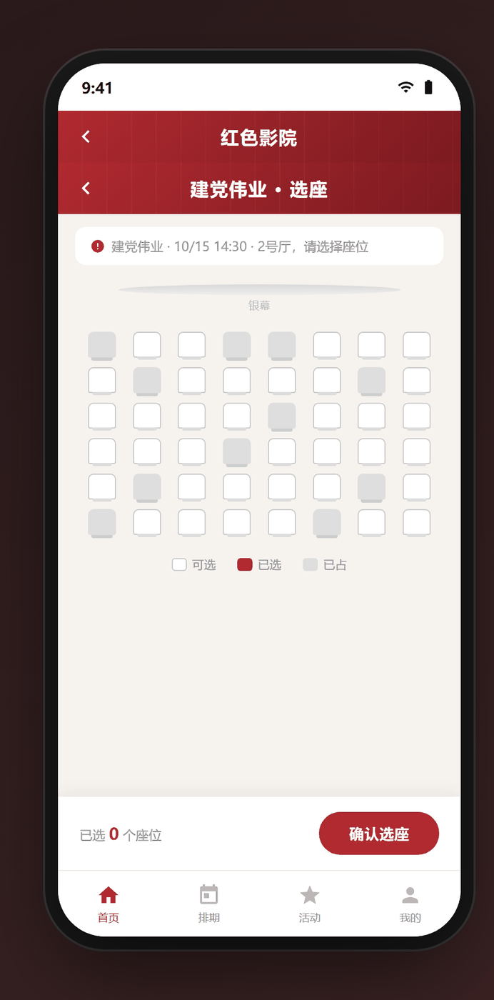
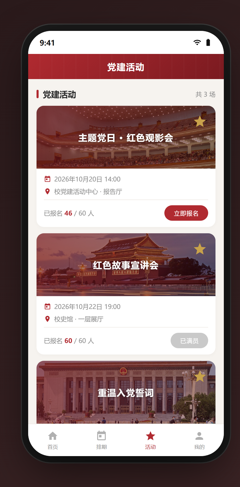
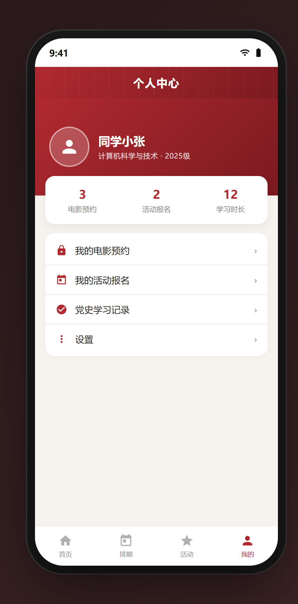

# 红色影院小程序

这是课程设计做的东西。名字听着挺正式，实际就是把"红色电影"和"党建活动"这两件事塞进一个微信小程序里，让人不用跑线下，在手机上就能看排片、约场次、报名活动，顺带翻点党史内容。

做这个没多想，课程设计要交，就挑了个自己够得着、又能把微信小程序那些知识点都串起来的题材。红色主题的好处是内容现成、方向明确，不至于做着做着跑偏了。

先看看它长什么样。首页是电影列表加快捷入口，底部四个 tab：首页、排期、活动、我的。五个主要页面都在这：

<div class="shot-row">
  <figure><figcaption>首页</figcaption></figure>
  <figure><figcaption>放映排期</figcaption></figure>
  <figure><figcaption>在线选座</figcaption></figure>
  <figure><figcaption>党建活动</figcaption></figure>
  <figure><figcaption>个人中心</figcaption></figure>
</div>

## 为什么是原生 + 云开发

技术栈没纠结太久：**微信原生小程序 + 云开发**。前后端都是自己啃，没请外援。

选原生是因为课程就教这个，而且小程序官方那一套（WXML + WXSS + JS，加个组件化的 WXS）跟学过的前端大同小异，上手不慢。云开发是它顺带送的福利——云数据库、云函数、云存储三件套，**不用自己搭服务器、不用管域名备案**，对一个人做课程设计来说，这是最省事的路子。真要自己搞个后端出来，光部署和备案就能把时间吃光。

一开始我也担心"云开发是不是不够正经"，后来发现担心的点不在这。真做的时候，坑全在别处。

## 功能拆开看

页面不少，但真正花心思的是这几个。

**红色电影列表**，这个最简单，云数据库里一张表，前端拉下来渲染就行，配个搜索和分类筛选。难的是后面。

**放映排期**，电影不是想约就约的，得有场次。这里要存"哪部片、哪天、哪个时间段、剩多少座"，排期表跟电影表关联起来。做的时候才意识到，**排期和座位是绑在一起的**，排期只是入口，真正的麻烦在座位。

**在线预约选座**，这个是我觉得最像"真东西"的部分。一个场次几十个座位，怎么把"这个座位已经被占了"这件事实时反映出来，是核心问题。

最笨的办法：用户点选座的时候，把选中的座位直接写进数据库，然后刷新。但这有个问题——**两个人同时选同一个座位怎么办？** A 先选了三排五座，还没来得及提交，B 也点了三排五座，结果两个人"都成功了"，后写的把先写的盖掉。

```js
// 预约时用云数据库的原子操作，抢占座位
db.collection('seats').where({
  sessionId,
  seatNo: selectedSeat,
  status: 'free'        // 只有空闲状态才更新
}).update({
  data: { status: 'booked', userId: openid }
}).then(res => {
  if (res.stats.updated === 0) {
    // updated 是 0，说明这个座位刚刚被人抢走了
    wx.showToast({ title: '手慢了，座位已被约', icon: 'none' })
  }
})
```

核心思路就是利用 `where` 条件里带上 `status: 'free'`，再加上 `update` 的返回里有个 `stats.updated`——**只有真正把状态从"空闲"改成"已约"的那一次，updated 才会是 1**。谁抢到就是谁，抢不到就提示重选。这个机制想通之后，才明白为什么大家老说"数据库的原子操作"，原来就为防这种"同时点"的情况。

选座页里，中间那条弧线是银幕，座位分可选（白）、已选（红）、已占（灰）三种状态。

**党建活动报名**，跟电影预约是两套逻辑。活动不选座，但要存"报名了谁、多少人、有没有上限"。报名上限的判断也踩了类似的坑——如果先查人数再判断，中间隔的那一下就可能超员，所以同样是"条件更新"那套思路，人数没满才允许插入。

活动页里，每场活动显示时间地点和报名进度，名额满了按钮就置灰。

**党史内容展示**，纯内容页，图文列表 + 详情，没什么技术含量，纯粹把红色题材的"内容感"撑起来。

最后是个人中心，能看到自己的电影预约、活动报名和学习时长，页面朴素但该有的都有。

## 几个印象深的坑

**云开发的数据库权限**，这个坑得最冤。云数据库默认权限是"仅创建者可读写"，一开始我在开发者工具里测得好好的，一到真机就全读不出来，折腾半天才发现是权限没放开。后来改成"所有用户可读、仅创建者可写"，电影列表这类公开数据才正常。

**环境 ID 配错**。云开发初始化要传环境 ID，那串字符长得都差不多，一开始手滑写错一位，云函数全调用失败，报错还看不出跟环境有关，纯靠对比文档一行行查出来的。

**开发者工具和真机是两回事**。云函数在工具里跑通了，真机上就超时，查了半天是本地调试和云端部署的环境变量没对上。这种"工具里好使、真机里不行"的差异，微信小程序里尤其多，得养成每个功能都在真机预览里过一遍的习惯。

## 做完回头看

这个项目说不上多高级，但它是那种"看着简单、真做全是细节"的典型。选座那套"条件更新防并发"的思路，是我觉得最值的东西——它让我第一次真正理解了为什么要有原子操作、为什么不能"先查再改"。剩下的列表、表单、云存储，都是熟练度问题，做多了自然顺。

课程设计交完之后它就没再维护了，但那段"同时抢一个座位"的思考，比代码本身记得还清楚。

## 源码

这个小程序的界面原型（可交互）已开源，可以直接在浏览器里点着玩：

👉 [GitHub - red-cinema-mini-program](https://github.com/freedom-thinking/red-cinema-mini-program)
