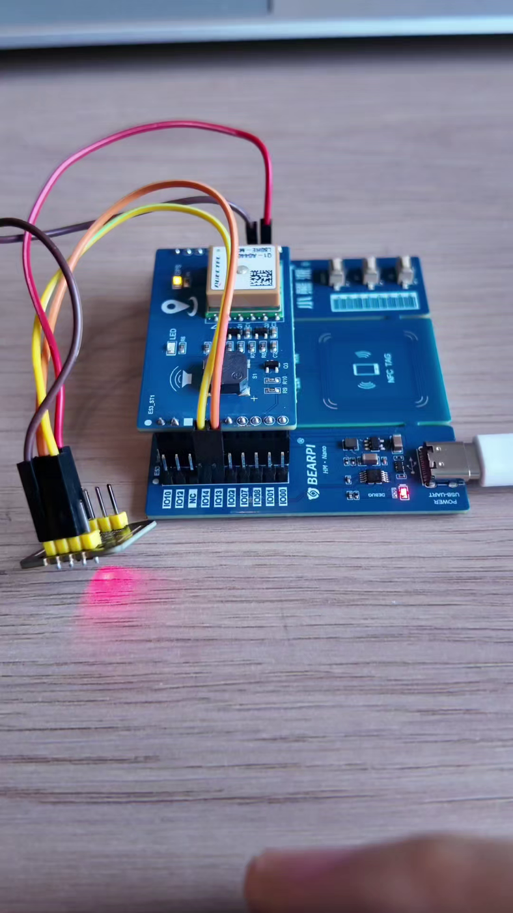
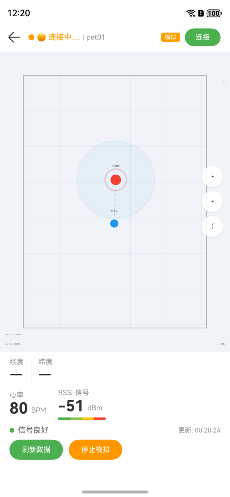
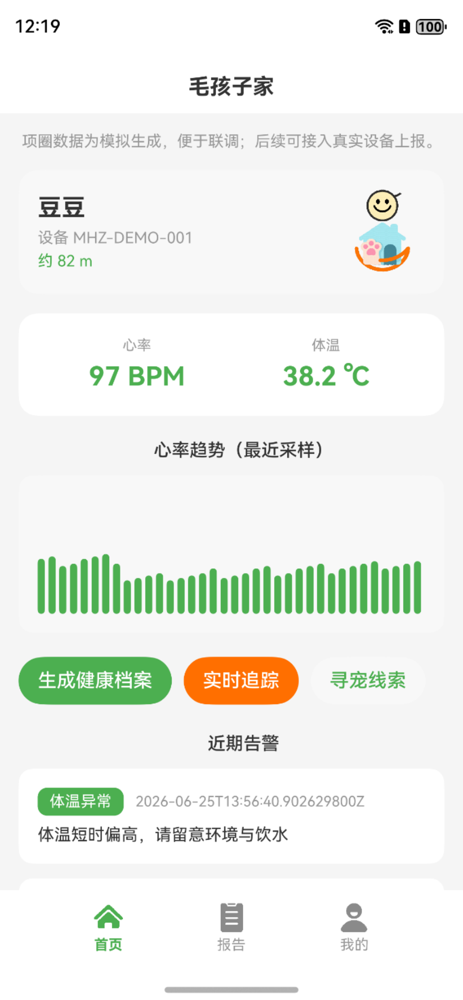
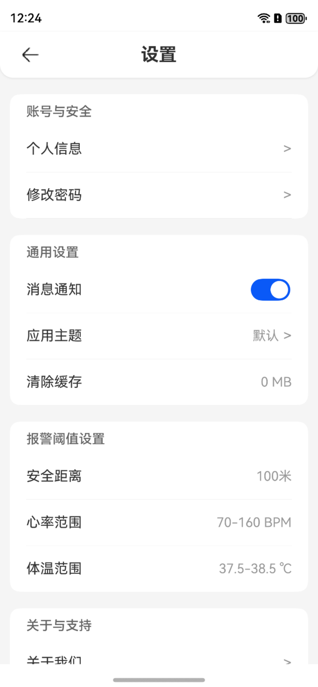
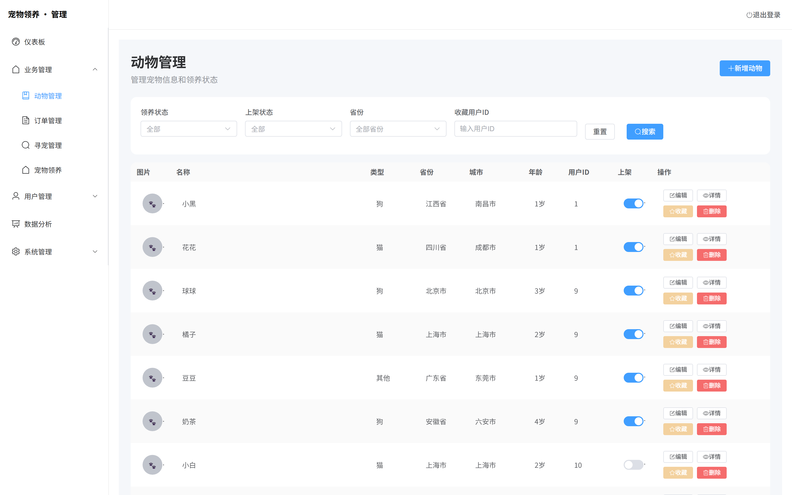
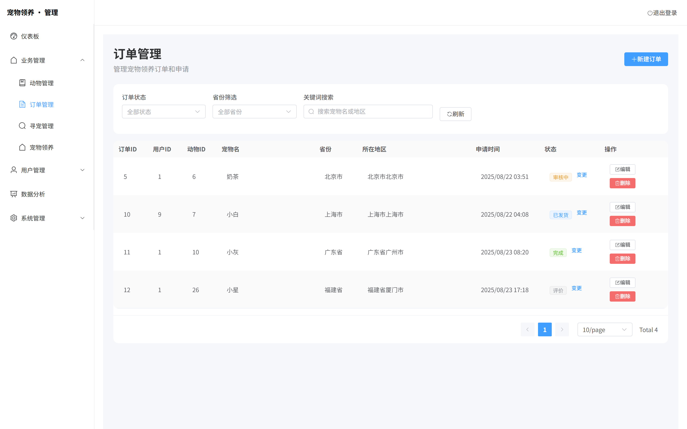
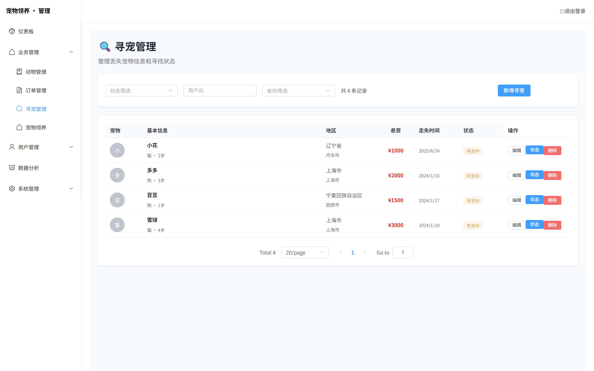

# 鸿蒙智能宠物项圈：一条从 160MHz 芯片走到手机上的链路

这个项目是给广东省大学生计算机设计大赛做的，赛道名字很长，叫「基于开源鸿蒙的智能宠物关怀产品开发挑战赛」。队名「勇敢牛牛」，我是队长。

作品名报上去叫「毛孩子家」。我一直觉得这名字有点土，但比赛要求有个名字，就这么用了，下面还是叫它项圈比较顺。

最开始它其实不是项圈。

题目给下来的时候，我第一反应是做 App —— 宠物领养、寻宠、签到、收藏，一套流程下来都是我做熟的东西。所以那个仓库到现在还叫 `HarmonyOS-Pet-adoption-platform`，README 里写的是「全栈宠物领养管理系统」，跟项圈没什么关系。做了一半我才反应过来问题在哪：「领养」和「关怀」不是一回事，一个领养平台讲的是一次性的匹配，而「关怀」得是每天、每时每刻都在发生的事。评委要是问一句「你的硬件呢」，我拿不出东西。

于是就加了这个项圈。

说清楚它是什么：项圈戴在狗脖子上，测心率和位置，数据走 Wi-Fi 报到华为云，手机 App 里能看到「狗现在在哪个方向、离我多远、心跳多少」，超出安全距离或者心率异常就弹告警。就这么一件事，从头到尾五层：传感器、主控、云、后端、App。

## 硬件那一层

手上其实是很普通的一套东西：一块小熊派的 BearPi-HM Nano 开发板、一颗 MAX30102、一块 ATGM332D 的 GPS 模块，加上一堆杜邦线。

选 Hi3861 不是因为它强，恰恰是因为它够用而且省事。160MHz 主频、352KB SRAM、2MB Flash，跑 LiteOS 加一层 Wi-Fi 协议栈之后基本就不剩什么了 —— 但这块芯片把 Wi-Fi 直接做在里面，我不需要再挂一个 ESP8266 之类的联网模组，也不用为两个芯片之间的串口再写一遍协议。对一个要跑三个月原型的项目来说，「少一个器件」比「多 20MHz」值钱得多。

MAX30102 是光学心率，PPG 原理：红光和红外光打进皮肤，看血液搏动带来的吸收变化。它只占 I2C 两根线，工作电流不到 1mA。GPS 那块走 UART，9600 波特率，一行一行往外吐 NMEA 语句，`$GNRMC` 里就有经纬度。



照片里那根亮着的红光就是 MAX30102 在工作。上面那块小板是 GPS，天线朝上 —— 这类模块冷启动三十几秒是正常水平，不是模块坏了，室内基本定不到位。

接线的时候有两条规矩，都是那种「错了不报错、只是数据永远不对」的坑：

GPS 的 TX 必须接主控的 RX。名字看着反，其实很合理 —— 一方的发送端接另一方的接收端。接成 TX-TX 的话，串口照样能打开、程序照样在跑，就是一个字节都收不到。

MAX30102 的地要单独走。它里面是模拟前端，测的是微安级的电流变化，数字地上 Wi-Fi 发射时的抖动会直接串进去，心率就变成一条锯齿。所以原理图里我给它留了一个独立的 AGND，最后用一颗磁珠单点接回数字地。

PCB 我用立创 EDA 画到了原理图这一步：TP4056 管充电、RT9013 把锂电池的 3.0~4.2V 稳到 3.3V、CH340N 做 Type-C 下载串口，五个电源网络（5V_USB / VBAT / 3V3 / GND / AGND）全部分开标号。装配体也出了 STEP 文件。

但是没打板。

原因很实在：打一次板要等两周，改一根线要再等两周，比赛周期里我赌不起。所以整个原型是拿开发板飞线跑通的，PCB 停在「画完了但没验证」的状态。这是我这个项目里最不完整的一块，我不想写成「已完成」。

外壳和佩戴方式长这样，蓝色织带可调节，主机卡在中间那个黑色壳子里：


## 数据是怎么从芯片走到手机的

整条链上只有一个 broker，但连着两头：

```
项圈 (Hi3861 + Wi-Fi)
   │  MQTT 3.1.1  属性上报
   ▼
华为云 IoTDA（设备接入 + Broker）
   ├── 订阅 ──▶ 鸿蒙 App      实时看板，看到即所得
   └── 订阅 ──▶ SpringBoot    落库 / 算距离 / 生成告警
```

一开始只有上面那条分支。App 直接订阅设备属性上报的 topic，改一行代码就能看到数字变，调 UI 特别快。

后来问题来了：关了 App 谁来看宠物？历史数据去哪查？距离谁来算？于是后端也挂了一个 MQTT 客户端（`IotdaMqttService.java`，357 行，Paho 实现），订阅同一个 topic，把位置和体征写进 MySQL。两条路并存到现在。

为什么用华为云 IoTDA，而不是自己装 EMQX？因为自己搭要一台有公网 IP 的服务器，装 broker、写转发、配证书。IoTDA 注册一个设备就给你 broker 地址、设备 ID 和设备密钥，免费额度够调试，而且它本来就是鸿蒙生态里的东西，接起来顺。

代价是**设备密钥要出现在客户端**。App 侧的 broker 配置我一开始就写死在常量里了（`DEFAULT_IOTDA_CONFIG`），装包拆开就能拿到，拿到就能伪造这台设备上报假数据。后端的密钥同样躺在 `application.properties` 里。这件事我在设计文档里写了「MQTT over TLS、双向认证」，代码里一条都没做到 —— 1883 是明文端口，连接也没做双向验证。比赛能糊过去，真上线不能这么干。

## 没有 MQTT 库，那就自己写一个

这是我在这项目里花时间最多、也最有意思的一段。

先说清楚卡在哪。ArkTS 里能用的网络能力是 `@ohos.net.socket` 和 `@ohos.net.http`，一个是裸 TCP/UDP，一个是 HTTP 请求。**没有 MQTT 客户端**。npm 上现成的 `mqtt.js` 也用不了，它依赖 Node 的 `net` 和 `Buffer`，ArkTS 编译期就直接过不去 —— 它不是「跑起来有点问题」，是根本进不了构建。

那退一步行不行？

第一个想法是 HTTP 轮询。不行。IoTDA 的设备侧接口是给 MQTT/CoAP 用的，属性上报不是一个「GET 一下就能拿到最新值」的 HTTP 接口。你想实时拿数据，只有订阅这一条路。

第二个想法是让后端去连 MQTT，App 轮询后端。这是**正确**的架构，也是我后来想明白了应该这么做的。但当时我没有那台公网服务器，绕了一圈又回到原地。

所以只剩一个选项：照着协议自己写。

写之前我先把 MQTT 3.1.1 的报文结构捋了一遍，其实没那么玄。每个报文都是三段：

```
固定头 (1 字节)  →  高 4 位是报文类型，低 4 位是标志
剩余长度 (1~4 字节) →  变长的 base-128 编码
可变头 + 载荷
```

「剩余长度」这个编码值得单独说一下，因为它是最容易写错的一处。它不是普通的整数，是每个字节只用低 7 位存数据、最高位当「后面还有」的开关，而且是低位在前：

```ts
function encodeRemainingLength(length: number): Uint8Array {
  const bytes: number[] = [];
  let remaining = length;
  do {
    let byte = remaining % 128;
    remaining = Math.floor(remaining / 128);
    if (remaining > 0) {
      byte |= 0x80;   // 还有后续字节
    }
    bytes.push(byte);
  } while (remaining > 0);
  return new Uint8Array(bytes);
}
```

一个长度值 200 会被编成 `[0xC8, 0x01]`：200 % 128 = 72，最高位置 1 之后是 72 + 128 = 200，也就是 `0xC8`；商是 1，接着放 `0x01`。

实际要实现的报文只有四个：CONNECT、SUBSCRIBE、PUBLISH（只收不发）、PINGREQ。DISCONNECT 顺手也给了一个两字节常量。

真正的麻烦不在报文格式，在认证。

华为云 IoTDA 不用「用户名 + 密码」那一套，它要求：

- `clientId` = `设备ID_时间戳`（秒级）
- `password` = `Base64( HMAC-SHA256(设备密钥, 同一个时间戳) )`

两处的 timestamp 必须**完全一致**。这一点很容易踩：构造 clientId 取一次时间、算密码又取一次，两次之间只要跨过一个整秒，算出来的密码就是错的 —— broker 返回码 4，「用户名或密码错误」。这个错误的迷惑性在于它不总是出现，看起来像网络抖动。

而要算这个 HMAC，我得先有 SHA-256。ArkTS 里不是完全没有密码学能力，`@ohos.security.cryptoFramework` 有，但它是按 Cipher / Sign / Mac 那套异步接口组织的，为了算一个 HMAC 去拼一套密钥对象和回调，比自己写还绕。于是我干脆把 SHA-256 按 FIPS 180-4 硬写下来了：64 个轮常量、8 个初始哈希值、64 轮压缩。从常量表到 HMAC 再到 Base64，一共一百五十行左右。

写完 SHA-256 有个必须注意的地方：JavaScript 的位运算默认是 32 位有符号整数，加法和乘法会溢出成浮点数。所以每一轮累加后面都得补一个 `| 0`，把它强行截回 32 位。少写一个，前几百次看着都对，某一次输入进来就错。

第三个坑，也是最难的一个：**TCP 是字节流，不是消息队列**。

broker 一次 `send` 过来的数据，可能是一个完整报文、可能是半个报文、也可能是三个半。如果你按「收到一次数据就当成一个包解析」，那上线之后必然间歇性崩 —— 而且崩得毫无规律，因为什么时候拆包取决于网络。

所以接收端必须自己维护缓冲区：新数据追加到尾部，从头循环尝试解析，解析不完整就跳出等下一批，解析成功就把已消费的字节切掉。

```ts
let offset = 0;
while (offset < this.receiveBuf.length) {
  const result = parseMqttPacket(this.receiveBuf, offset);
  if (!result) {
    break;  // 报文还不完整，等更多数据
  }
  this.handlePacket(result.type, result.flags, result.payload);
  offset += 1 + rlBytesUsed + result.payload.length;
}
if (offset > 0) {
  this.receiveBuf = this.receiveBuf.slice(offset);
}
```

最后这个 830 多行的 `IoTMqttService.ets` 里有：单例 + 回调注册、40 秒一次的心跳（KeepAlive 设 60 秒，留三分之一余量）、断线重连（3 秒起，每次乘 1.5，封顶 30 秒，最多 5 次）、CONNACK 六种返回码的中文解释，还有一个 Mock 模式 —— 没设备的时候每 3 秒造一组经纬度漂移和 55~85 的心率，UI 和交互逻辑照样能调。

Mock 这个我一直觉得是这次做对的一件事。**没有硬件不等于不能开发**，把数据源抽象成一个可替换的回调，假数据也能把整条链路（订阅 → 解析 → 状态更新 → 重绘）跑通。

## 地图是我拿 Canvas 画的

这一页（`PetCollarTracker.ets`，920 行）是整个 App 里最花哨的部分：



中间那个红点是宠物，蓝点是主人，中间虚线连着，外面一圈半透明的圆是按 RSSI 估的信号范围。

下面一行「经纬度：—」是空的，因为我当时没把原始经纬度打到界面上（只画在图上），这是个明显的产品缺陷 —— 用户想报位置给别人的时候没有可复制的坐标。

**为什么不用华为 Map Kit？**

Map Kit 要先在 AGC 建项目、申请 API key、配签名证书，而且包名、证书指纹必须和工程对上。麻烦的地方不在步骤多，在**卡住之后没法归因**：证书没配上，地图就是一片空白，可你分不清是网络问题、key 问题还是签名问题。

自己画的好处很直接：不联网、不要 key、不要证书，位置一变，红点就动。经纬度按当前缩放档线性映射到像素，六档缩放分别是 2km / 1km / 500m / 200m / 100m / 50m 的跨度，双指捏合换档，单指拖动平移。

坏处也很直接：**它不是地图**。没有路网、没有地名、没有街道，用户看到的是「狗在我东南方向 80 米」，而不是「狗在小区门口那家便利店旁边」。所以这页能证明链路通了、能演示，但它替代不了真地图。

我在文件开头就写了这一句注释：真实的定位体验得靠 Map Kit，这里只做可视化和联调。

## 健康数据这块，一半是真的

App 首页长这样：



心率 97、体温 38.2、距离约 82 米。这三个数看着像测出来的，其实来历各不相同，我把代码翻出来对过了：

**距离是真算的，输入是假的。** 后端把宠物摆在 (31.2304, 121.4737)、主人摆在 (31.2310, 121.4742)，用 Haversine 公式算球面距离，得到 81.92 米，页面四舍五入显示「约 82 米」。公式没问题，那两个坐标是写死的常量 —— App 没申请定位权限，所以「主人在哪」这件事，程序是猜的。

**心率和体温是后端造的。** 设备 1 号是演示设备（豆豆 / MHZ-DEMO-001），库里没有它的真实采样，`PetCareSimulationService` 就按 15 分钟一条自动生成：

```java
v.setHeartRateBpm(88 + (phase % 9) + (int) (seq % 5));
v.setTemperatureC(38.0 + (phase % 6) * 0.07 + (seq % 3) * 0.02);
v.setActivityMinutes(30 + (phase % 4) * 5);
```

`phase` 是当前小时数、`seq` 是第几条。97 BPM 和 38.2 ℃ 就是这两个式子算出来的，跟传感器没关系。

**体温这条链路压根没通。** IoTDA 的属性上报里我只定义了五个字段：`lon`、`lat`、`hart_rate`、`heart_start`、`rssi`，**没有温度**。设计文档里写的 MLX90614 红外测温（±0.2°C）、MPU6050 活动量判断，器件最后都没上板。App 端 `HealthDataStore` 在本地兜底时也是随手一个随机数：

```ts
temperature: 38.0 + (Math.random() - 0.5) * 1.5,  // MQTT 无体温数据，用模拟值
```

所以首页的体温曲线、健康报告里的体温图、告警里那句「体温短期偏高，请留意环境与饮水」，全都建立在这几个式子上。

我没有把这段删掉，理由是：数据结构、图表逻辑、接口都是真的（换成真实数据源就能用），比赛演示也需要完整的产品形态。但要我把这条曲线说成「测出来的」，我不干。

跑通的是管线，不是测量。`HealthDataStore` 里 2000 条的内存缓冲、按天聚合成均值/极值/异常次数、Canvas 画折线柱状、报告页（860 行）的三张小图加建议，这些逻辑都在真跑；后端 `/vitals/trend`、`/archive/summary` 两个接口我也实测过，都是 200。

## 后端和库表

后端是 Spring Boot 3 + JPA + MySQL。这块我在仓库里留了两份：`backend/` 是只做项圈的独立小服务（1184 行、4 个 controller、跑 H2，起来零配置），`SpringBoot/` 是跟领养业务长在一起的全量服务（78 个文件，连 MySQL，项圈接口也在里面）。两边都能起，下面说的是后者 —— 因为它才是连着真实数据库的那套。

真正跟项圈有关的只有六张表：

```
pet_device       设备（序列号、绑定的宠物、固件版本、电量、最后在线）
vital_sample     体征采样（心率、体温、活动量、采样时间）
alert_record     告警记录（类型、级别、消息、已读、位置摘要）
location_ping    位置点
user_settings    用户级阈值
device_settings  设备级阈值
```

剩下二十来张是领养平台那套：省市区、宠物、订单、签到、收藏、实名认证。`pet_collar.sql` 两千多行，其中一千三百多条是省市数据，真正手写的表结构不到一百行 —— 这个比例挺说明问题的，**业务表很少，字典数据很多**。

有一个接口我自己比较满意。健康档案汇总：给定设备和一个时间段，后端算平均心率、平均体温、告警次数，然后直接拼一句话返回，比如：

> 统计时段内共采集 128 条生理数据，平均心率约 96 BPM，平均体温约 38.1 ℃，告警 3 次。

这个「叙述型摘要」是给报告页直接显示的，省得前端自己拼字符串、还要处理「没有数据」时句子不通顺。后端多做一点，前端就少一堆 if。

阈值那一页也是假的。设置页能看到这些数：



安全距离 100 米、心率 70–160 BPM、体温 37.5–38.5 ℃ —— 但这些值是 `getUserSettings()` 里写死的 `new` 出来的，`updateUserSettings()` 更干脆，函数体只有一行 `return true`。既不落库，也没有任何代码拿它去判断。**因为压根没有判断这条链路**：告警中心那三条（体温偏高 / 距离过远 / 电量低）是 `alertsForDevice()` 里手工 new 出来的 DTO，`alert_record` 表到现在还是 0 行。

所以「改阈值 → 触发告警」这个闭环，我只能说没做，不能说做了。

## 文档里写了、代码里没有的东西

设计文档我写了十一个章节（v1.0 是我自己写的，后来又出了一版增强的），里面有 C4 架构图、ADR 决策记录、API 契约、非功能指标。我得承认，里面相当一部分是**没落地的**：

- TDengine 存时序数据 —— 没有，全在 MySQL。
- Kafka 削峰 —— 没有，设备量小到不需要。
- Redis 缓存最新位置 —— 没有，直查库。
- MQTT over TLS + 双向认证 —— 没有，1883 明文端口，两边都是。
- MLX90614 体温、MPU6050 加速度 —— 没有，器件没上。
- 华为 Push Kit 推送 —— 没有，告警只在 App 里看得到。
- 告警规则引擎 —— 没有。设计文档里写了「心率/体温/距离三重判断 + 分级报警」，代码里一条判断都没有，`alert_record` 表是空的，告警中心显示的三条是演示数据。
- 「合并部署」—— 没有。仓库里现在是两套后端并存：`backend/` 是只跑项圈的 H2 版（4 个 controller，起起来零配置），`SpringBoot/` 才是连着 MySQL 跑全量的那套（78 个文件，项圈接口也在里面）。我当时想的是前者当独立微服务、后者当主服务，实际就一直这么并排放着，没合并。

这种事我不想粉饰。文档写的是「这个产品做完整应该长什么样」，代码写的是「三个月我能做出什么」，两个都是真的，但不能混着说。

## 把后端跑起来之后

写这篇之前我把 `SpringBoot/` 那套真跑了一遍（JDK 17 + MySQL 8，`mvn spring-boot:run`），确认接口是活的，不是只写在文档里：

```bash
curl http://127.0.0.1:8080/api/pet-care/devices
# {"success":true,"data":[{"deviceSn":"MHZ-DEMO-001","petName":"豆豆",...}]}

curl http://127.0.0.1:8080/api/pet-care/devices/1/location/latest
# {"approximateDistanceMeters":81.92231118140296,"safeRadiusMeters":100.0,"isWithinSafeRadius":true}
```

上面那几个「假数据」的结论就是从这儿来的 —— 不是猜的，是接口原样返回 81.92 米，和 App 截图上的「约 82 米」对得上。

管理后台也起了（`vue`，Vite + Element Plus），顺手截了几张。这套是领养那条业务线，跟项圈共用同一个后端和同一个库：







界面谈不上好看，但它真连着 MySQL：动物 30 条、订单 4 条、寻宠 4 条，分页、筛选、状态流转都是从库里查出来的。仪表盘那页的四个数字（156 / 1248 / 89 / 67）是写死在组件里的，别当真。

## 如果重做

第一条不是「把 MQTT 挪到后端」—— 后端已经订阅了。第一条是**把密钥从客户端和配置文件里拿掉**：设备用一机一密加 TLS 接入，后端拿短期凭证去连，App 永远不碰 broker。现在这种「为了省一台服务器、把密钥抄进两个地方」的做法，省下的东西最后都要加倍还回去。

第二条，补传感器。体温在宠物场景里比心率更重要（发烧是猫狗最常见的急症信号），而我恰恰把它做成了公式。

第三条，地图换真的。Canvas 手绘在「证明链路通了」这个阶段是合理的，再往下走就必须上 Map Kit 或者高德、腾讯的 SDK。

## 最后的感受

这个项目是我第一次把「嵌入式 → 云 → App」这条链从头到尾自己走一遍。

以前写后端写前端的时候，数据都是我造的：想让它是什么就是什么，接口返回什么我就显示什么，出错了就看日志。这次真实的链路是：数据从一块 160MHz 的芯片里出来，信号不好它就是不来；传感器贴不紧，心率就是一条乱线；GPS 在室内就是定不到位，等三十秒也没用。

（当然，最后演示跑的是模拟数据这条支路 —— 上面那些「假」我都写明了。但接硬件那半个月踩的坑是真的。）

有一种很具体的感觉：**你没法跟硬件讲道理**。代码写错了可以改，天线位置不对、地没分干净、电池电压掉到 3.2V 以下 LDO 开始不稳，这些不是 `console.log` 能解决的，得拿万用表去量。

这三个月里我改得最多的不是 UI，是「为什么数据没上来」。这个问题的答案分布在五个层里，而每一层都可能骗你 —— 云端显示设备离线，可能是 Wi-Fi 没连上，可能是 MQTT 认证失败，可能是报文粘包解析崩了，也可能只是电池没电。

把这五种可能一条条排掉的过程，比写完那两万行 ArkTS 学到的东西多。
