# 鸿蒙智能宠物项圈

本项目是一套面向家庭养宠场景的软硬件一体化系统。佩戴于宠物颈部的智能项圈负责采集心率与位置数据，经 Wi-Fi 上报至华为云物联网平台；鸿蒙移动端提供实时状态与健康档案，Vue 管理后台承担业务数据管理，Spring Boot 后端完成数据落库、距离计算与健康报告生成。

作品名称为「毛孩子家」，参加广东省大学生计算机设计大赛「基于开源鸿蒙的智能宠物关怀产品开发挑战赛」。项目由本人独立完成，涵盖硬件选型与调试、移动端、后端、管理后台以及设计与开发文档。

本文按「系统定位、架构组成、各端实现、当前完成度」的顺序说明。

## 一、项目概述

- **作品名**：毛孩子家 · 智能宠物项圈
- **形态**：项圈原型（硬件）+ 鸿蒙 App + 管理后台 + 后端服务
- **场景**：宠物定位防走失、心率监测、健康档案与异常提醒
- **分工**：独立完成全部模块，含硬件选型与接线、移动端、后端、管理后台、设计与开发文档
- **规模**：ArkTS 52 个文件 / 20232 行；后端 78 个 Java 文件；管理后台 12 个功能页
- **技术栈**：Hi3861（OpenHarmony / LiteOS）· MQTT 3.1.1 / 华为云 IoTDA · ArkTS + ArkUI · Spring Boot 3 + JPA + MySQL 8 · Vue 3 + Element Plus + ECharts

系统由四个部分构成，任一环节缺失都会导致链路中断：

- **感知端**：Hi3861 主控配合 MAX30102 心率传感器与 ATGM332D 定位模块，通过板载 Wi-Fi 直接上报。
- **云平台**：以华为云 IoTDA 作为 MQTT Broker，设备注册后即可接入，无需自建服务器。
- **服务端**：Spring Boot 订阅同一主题完成数据落库，对外提供设备、体征、告警、健康档案四组 REST 接口。
- **应用端**：鸿蒙 App 面向宠物主人，Vue 管理后台面向运营人员。

## 二、系统架构

```
┌──────────────────┐
│  项圈（Hi3861）   │  MAX30102 (I2C) + ATGM332D (UART)
└────────┬─────────┘
         │ MQTT 3.1.1  属性上报
         ▼
┌──────────────────┐
│ 华为云 IoTDA      │  $oc/devices/{deviceId}/sys/properties/report
└───┬──────────┬───┘
    │ 订阅      │ 订阅
    ▼          ▼
┌────────┐  ┌──────────────────────┐
│ 鸿蒙 App│  │ Spring Boot 后端      │
│ 实时看板│  │ 落库 / 算距离 / 出档案 │
└────────┘  └──────────┬───────────┘
                       │ REST（/api/pet-care/**）
                       ▼
                  ┌─────────┐        ┌──────────────┐
                  │  MySQL  │◀───────│ Vue 管理后台  │
                  └─────────┘        └──────────────┘
```

一次完整的采集与展示过程分为四步：

1. 项圈按周期采集，将 `lon`、`lat`、`hart_rate`、`heart_start`、`rssi` 五个字段组织为 IoTDA 要求的 JSON 结构上报。
2. IoTDA 将消息分发给两个订阅者：移动端用于实时展示，后端用于持久化。
3. 后端解析报文后写入 `location_ping` 与 `vital_sample` 两张表，并以 Haversine 公式计算宠物与主人之间的距离。
4. 移动端通过 REST 接口获取最近体征、告警与档案摘要；管理后台通过同一套接口完成列表查询与统计。

## 三、硬件设计

硬件原型基于小熊派 BearPi-HM Nano 开发板搭建，外接 MAX30102 心率传感器与 ATGM332D 定位模块。


主控选型优先考虑集成度。Hi3861 主频 160MHz，352KB SRAM、2MB Flash，运行 LiteOS 与 Wi-Fi 协议栈后可用资源有限，但该芯片将 Wi-Fi 集成在片内，无需外接 ESP8266 一类联网模组，也省去了两颗芯片之间的串口通信协议。对周期约三个月的原型开发而言，减少器件数量比提升主频更有价值。

三颗器件分别占用不同的总线：

| 器件 | 功能 | 接口 | 关键参数 |
| --- | --- | --- | --- |
| MAX30102 | 光学心率采集（PPG，红光与红外光检测血流搏动） | I²C，两线 | 工作电流小于 1mA |
| ATGM332D | GPS / 北斗定位，输出 NMEA 语句 | UART，9600bps | 冷启动约 30 秒，室内难以定位 |
| Hi3861 | 主控与 Wi-Fi | — | 160MHz / 352KB SRAM / 2MB Flash |

接线阶段有两项容易出错且不会产生报错的约束：

**GPS 的 TX 需连接主控的 RX。** 串口通信为交叉连接，若误接为 TX-TX，串口仍可正常打开、程序仍可运行，但无法接收到任何数据。

**MAX30102 的模拟地需独立走线。** 该器件内部为模拟前端，检测的是微安级电流变化，数字地上的 Wi-Fi 发射抖动会直接耦合进信号，导致心率波形出现锯齿。原理图中为其分配了独立的 AGND，最终通过一颗磁珠单点连接至数字地。

PCB 在立创 EDA 中完成至原理图阶段：TP4056 负责充电管理，RT9013 将锂电池的 3.0~4.2V 稳压至 3.3V，CH340N 提供 Type-C 下载串口，五个电源网络（5V_USB / VBAT / 3V3 / GND / AGND）均独立标注，装配体同步导出 STEP 文件。

PCB 未进入打样阶段。打样周期约两周，改线后需再等待两周，在比赛周期内无法承担该时间成本。因此原型以开发板飞线方式验证功能，PCB 停留在「原理图完成、未经打样验证」的状态。

外壳与佩戴结构如下，主体卡入中间黑色壳体，配可调节尼龙织带：


## 四、移动端应用

移动端采用 ArkTS + ArkUI 开发，共 52 个 `.ets` 文件、20232 行代码。功能分为两条业务线：智能项圈的健康监控，以及领养平台的寻宠、收藏、地址与实名认证。

以下页面均在 HarmonyOS 5.0.1 模拟器中实际运行后截取。

**登录 / 注册 / 首页看板 / 实时追踪 / 健康档案**

<div class="shot-row is-compact">
  <figure>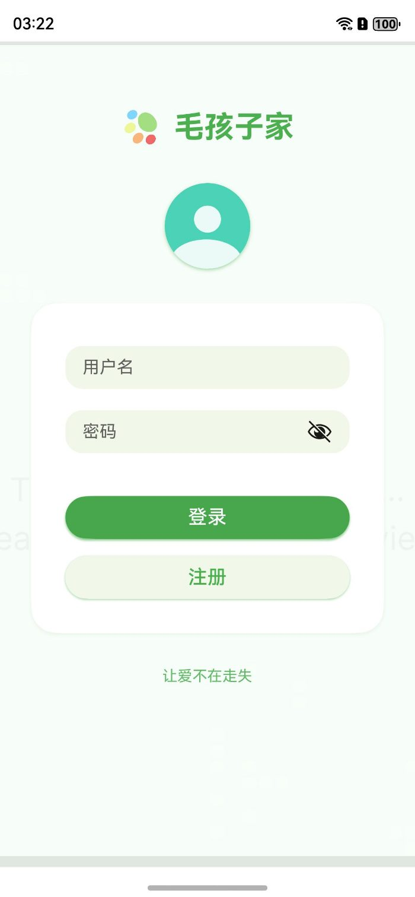<figcaption>登录</figcaption></figure>
  <figure>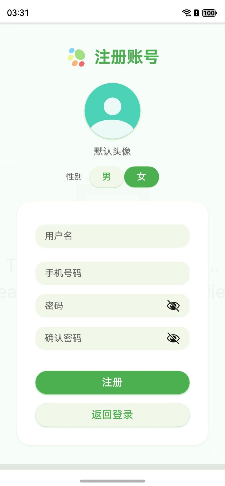<figcaption>注册</figcaption></figure>
  <figure>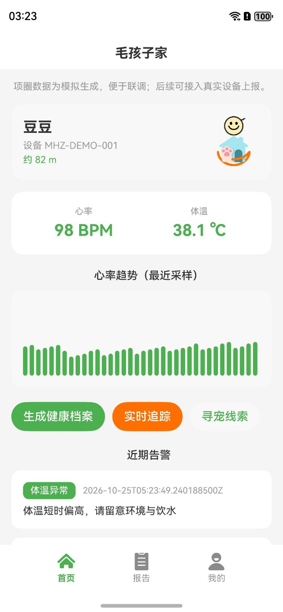<figcaption>首页看板</figcaption></figure>
  <figure>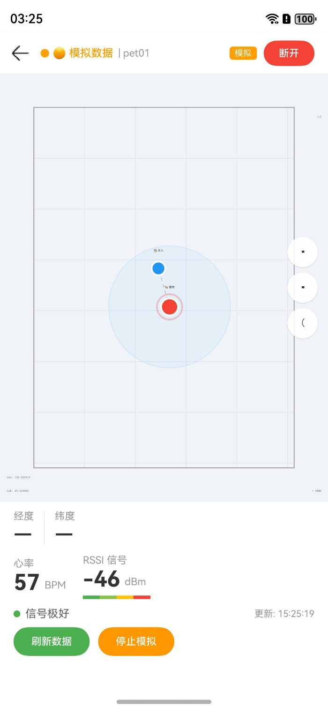<figcaption>实时追踪</figcaption></figure>
  <figure>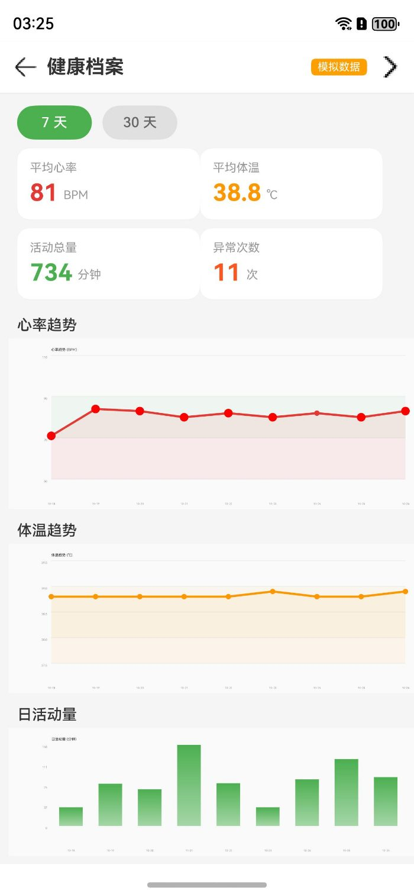<figcaption>健康档案</figcaption></figure>
</div>

**健康数据 / 健康报告 / 报警中心 / 设备管理 / 我的**

<div class="shot-row is-compact">
  <figure>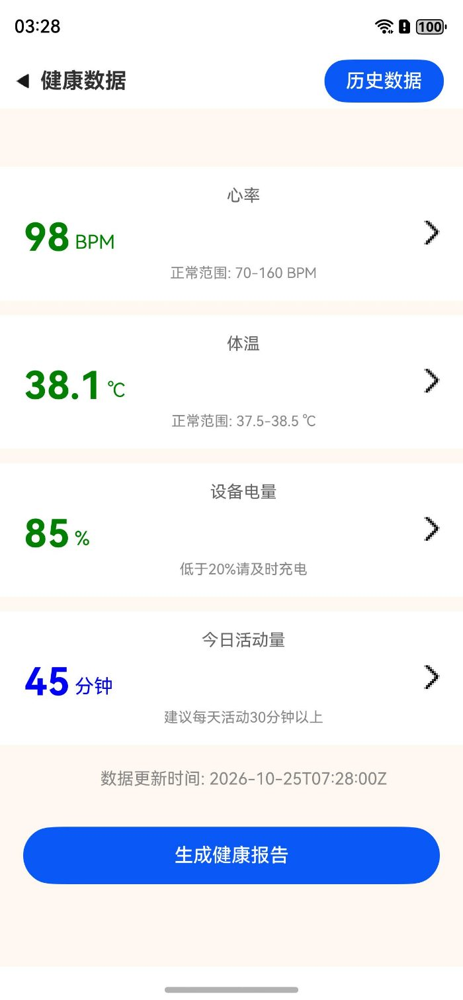<figcaption>健康数据</figcaption></figure>
  <figure>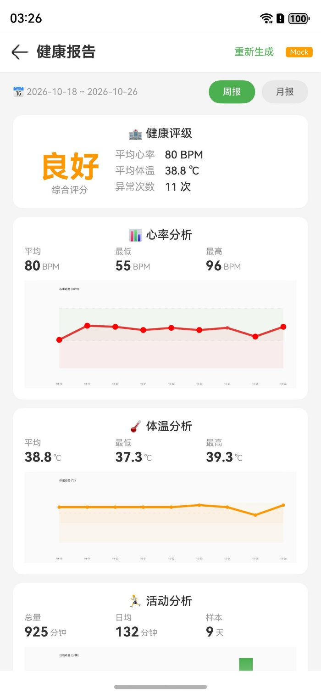<figcaption>健康报告</figcaption></figure>
  <figure>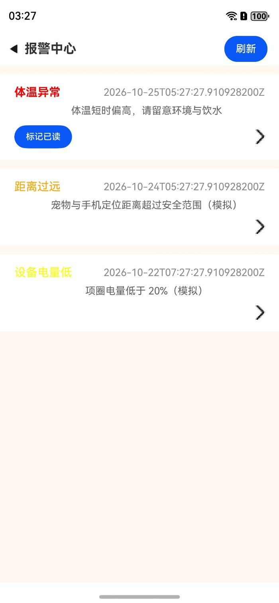<figcaption>报警中心</figcaption></figure>
  <figure>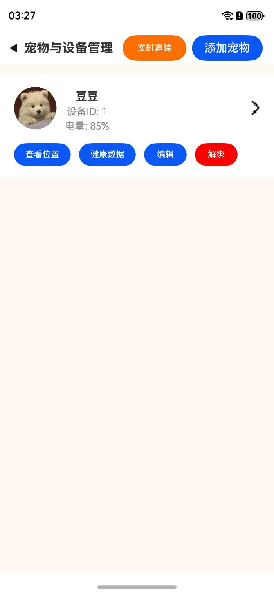<figcaption>设备管理</figcaption></figure>
  <figure>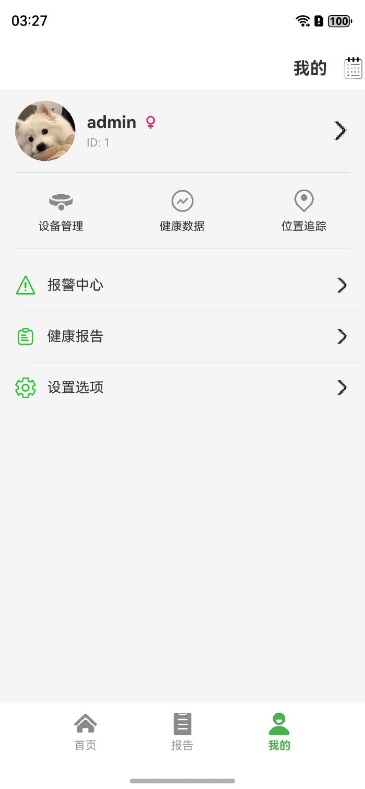<figcaption>我的</figcaption></figure>
</div>

**编辑资料 / 阈值设置 / 寻宠列表 / 寻宠详情**

<div class="shot-row is-compact">
  <figure>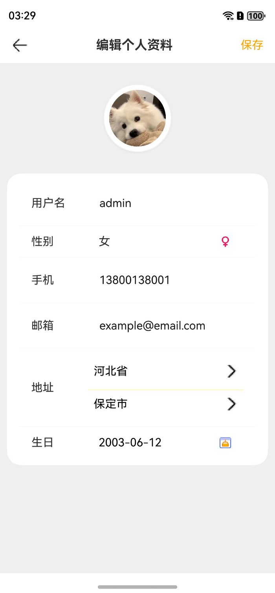<figcaption>编辑个人资料</figcaption></figure>
  <figure>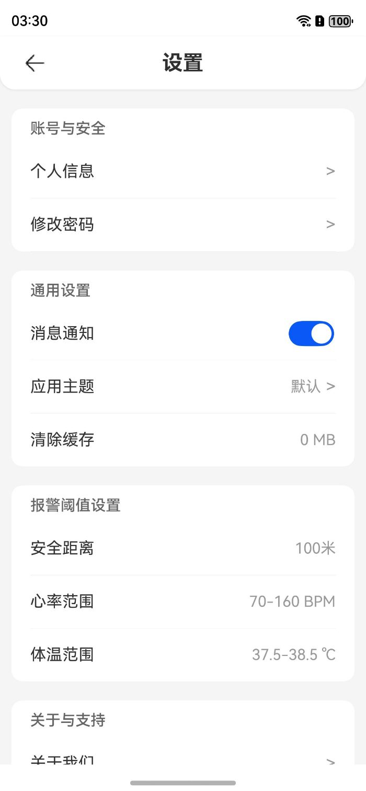<figcaption>阈值设置</figcaption></figure>
  <figure>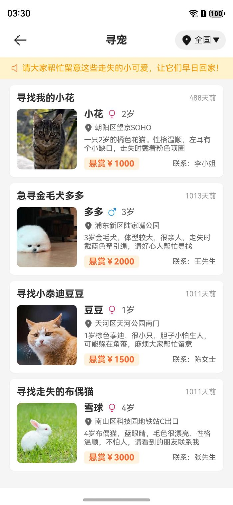<figcaption>寻宠列表</figcaption></figure>
  <figure>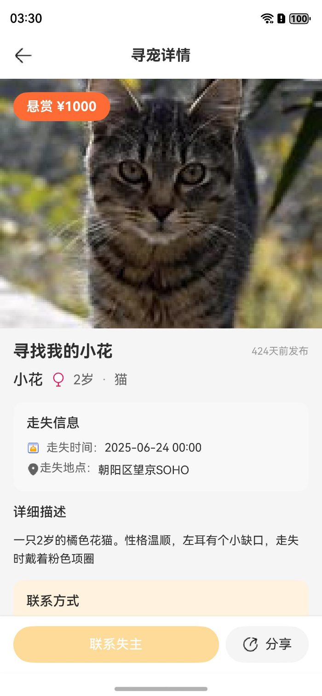<figcaption>寻宠详情</figcaption></figure>
</div>

各页面的功能说明如下：

- **首页看板**：宠物名、设备编号与距离，心率、体温两项主指标，最近采样的心率柱状图，三个功能入口以及最近一条告警。
- **实时追踪**：Canvas 绘制的相对位置图，包含宠物与主人两个标记、二者连线与 RSSI 信号圈，右侧提供缩放与回中操作。
- **健康档案**：支持 7 天 / 30 天切换，包含四项统计卡片与心率折线、体温折线、日活动量柱状三张图表。
- **健康报告**：按周或按月生成，给出综合评级，并按心率、体温、活动三部分输出极值统计与建议。
- **报警中心**：体温异常、距离过远、设备电量低三类告警列表，支持标记已读。
- **设备管理**：展示设备绑定关系与电量，提供查看位置、健康数据、编辑、解绑四项操作。
- **我的**：设备管理、健康数据、位置追踪三个入口，以及报警中心、健康报告、设置选项。
- **寻宠**：走失信息列表与详情页，包含悬赏金额、走失地点、发布时间与联系方式。

几处值得说明的交互设计：

**数据来源提示。** 首页顶部固定显示「项圈数据为模拟生成，便于联调；后续可接入真实设备上报」。在数据尚未接入真实设备的阶段，界面需要明确告知用户数据性质。

**地图采用 Canvas 自绘。** 未接入华为 Map Kit，而是按当前缩放档位将经纬度线性映射为画布坐标，绘制网格、标记与信号圈。六档缩放分别对应 2km、1km、500m、200m、100m、50m 的跨度，支持双指捏合换档与单指拖动。该方案无需联网、无需申请 API Key 与签名证书，联调成本低，但无法提供路网与地名词条，只能表达相对方位与距离。

**健康报告在本地生成。** 报告页不依赖后端接口，直接读取 `HealthDataStore` 中的采样数据完成聚合与绘图，因此断网状态下仍可使用。

**设置页集中管理告警阈值。** 安全距离 100 米、心率 70–160 BPM、体温 37.5–38.5 ℃ 三项参数位于设置页底部，其实际生效情况见第八节。

### 界面数据的来源

首页展示的三个数值（约 82 m、98 BPM、38.1 ℃）来源各不相同，逐一说明如下：

**距离由计算得出，输入为固定坐标。** 后端将宠物坐标设为 (31.2304, 121.4737)，主人坐标设为 (31.2310, 121.4742)，以 Haversine 公式计算球面距离，结果为 81.92 米，界面四舍五入显示为「约 82 米」。计算过程本身正确，但两个坐标均为常量——移动端未申请定位权限，主人位置实际由程序预设。

**心率与体温由后端生成。** 演示设备（豆豆 / MHZ-DEMO-001）在数据库中不存在真实采样记录，`PetCareSimulationService` 按 15 分钟一条的间隔生成数据：

```java
v.setHeartRateBpm(88 + (phase % 9) + (int) (seq % 5));
v.setTemperatureC(38.0 + (phase % 6) * 0.07 + (seq % 3) * 0.02);
v.setActivityMinutes(30 + (phase % 4) * 5);
```

其中 `phase` 为当前小时数、`seq` 为序号。98 BPM 与 38.1 ℃ 均由上述两式得出，与传感器无关。

**体温链路尚未打通。** IoTDA 属性上报中仅定义了五个字段，不含温度字段；设计文档中规划的 MLX90614 红外测温（±0.2°C）与 MPU6050 加速度计最终未接入硬件。移动端 `HealthDataStore` 在本地兜底时同样使用随机值：

```ts
temperature: 38.0 + (Math.random() - 0.5) * 1.5,  // MQTT 无体温数据，用模拟值
```

因此界面中的体温曲线、报告中的体温图表以及告警文案「体温短时偏高」，均基于上述公式而非实测值。

保留上述界面的原因是：数据结构、接口契约与图表聚合逻辑均为真实实现，替换数据源即可投入使用；比赛演示亦需要完整的产品形态。但在本文中，相关内容一律标注为模拟数据。

## 五、管理后台

管理后台采用 Vue 3 + Element Plus + ECharts，服务于领养业务，与项圈模块共用同一后端与同一数据库。共 12 个功能页，以下截图均在本机启动服务后逐页截取。

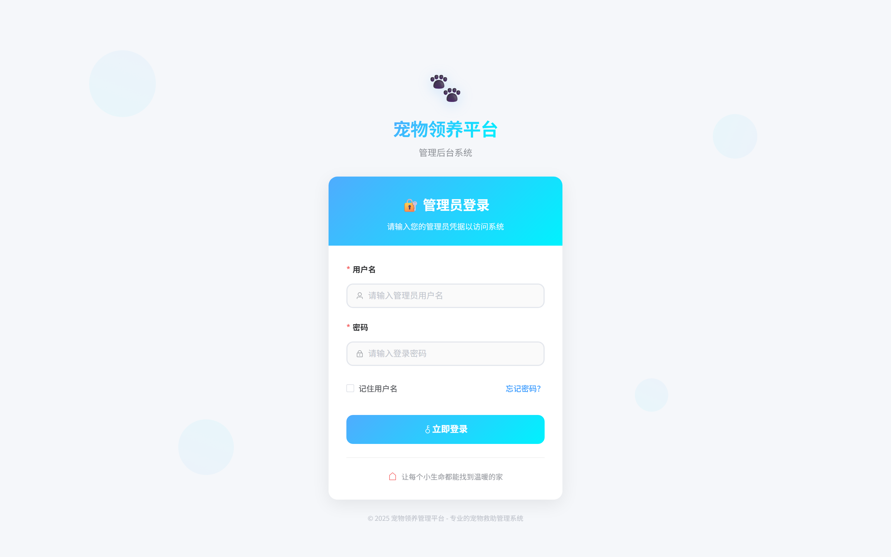

登录页左侧为品牌区，右侧为账号密码表单，通过 `POST /api/auth/login` 校验，成功后将用户信息写入 Pinia。演示账号为 `Admin / 123456`。

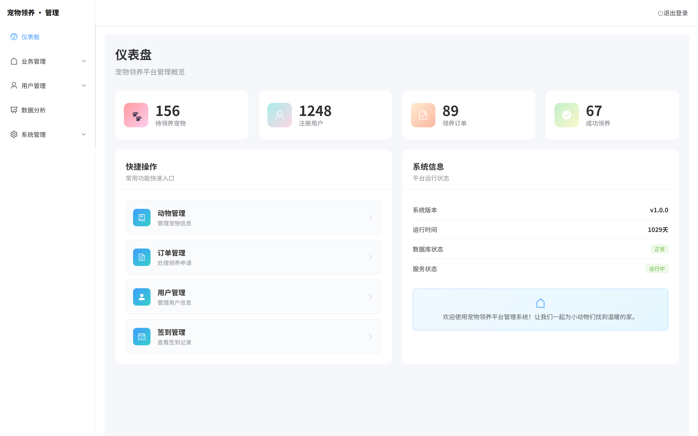

仪表盘包含四个指标卡（待领养、注册用户、领养订单、成功领养）、系统信息区（版本、运行天数、数据库与服务状态）以及四个常用入口。需要说明的是，四个指标卡的数值（156 / 1248 / 89 / 67）在组件中固定写入，并非数据库统计结果。

**业务管理**


动物管理是后台信息密度最高的页面，表格包含图片、名称、类型、省市、年龄、所属用户与上架开关，顶部提供领养状态、上架状态、省份三个筛选条件及收藏用户检索。数据来自 `animals` 表，共 30 条，分页、筛选与上下架操作均由后端完成。


订单管理覆盖领养申请全流程，状态分为审核中、已发货、完成、评价四种，支持编辑与删除。数据库现有 4 条记录。


寻宠管理维护走失宠物信息，包含悬赏金额、走失时间与所在地区，状态可在「寻宠中」与「已找到」之间切换。现有 4 条记录。

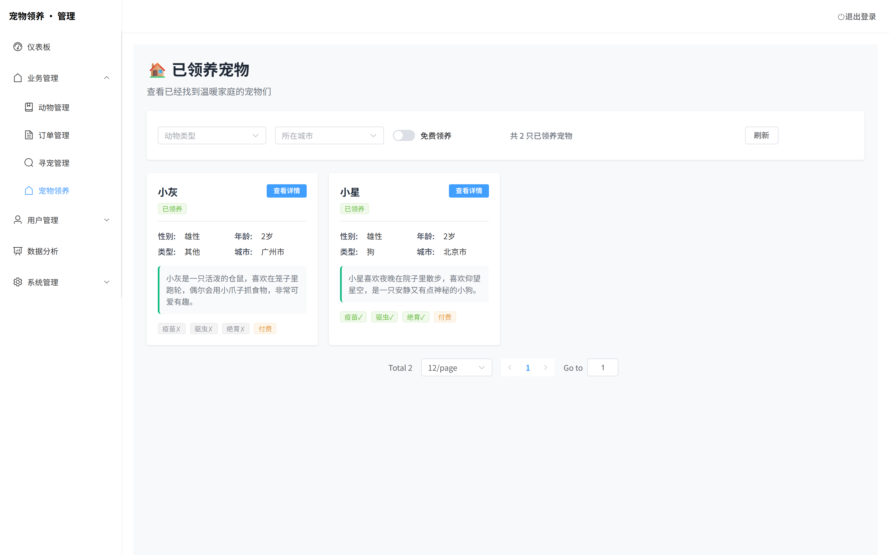

已领养页面采用卡片式布局而非表格，展示已完成领养的宠物及其性格描述、疫苗、驱虫、绝育、付费四项标记，共 2 条。

**用户管理**

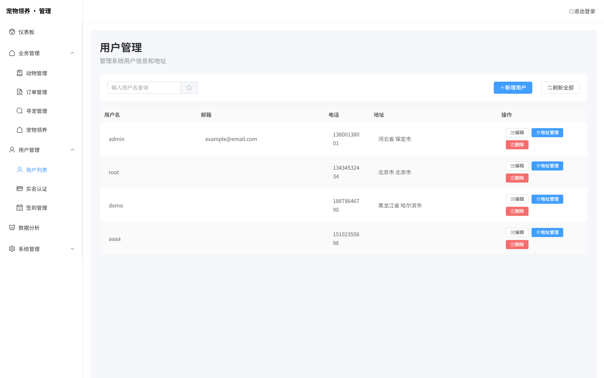

用户列表包含用户名、邮箱、电话与地址，支持按用户名检索，可进入地址管理或删除账号。现有 4 条记录。

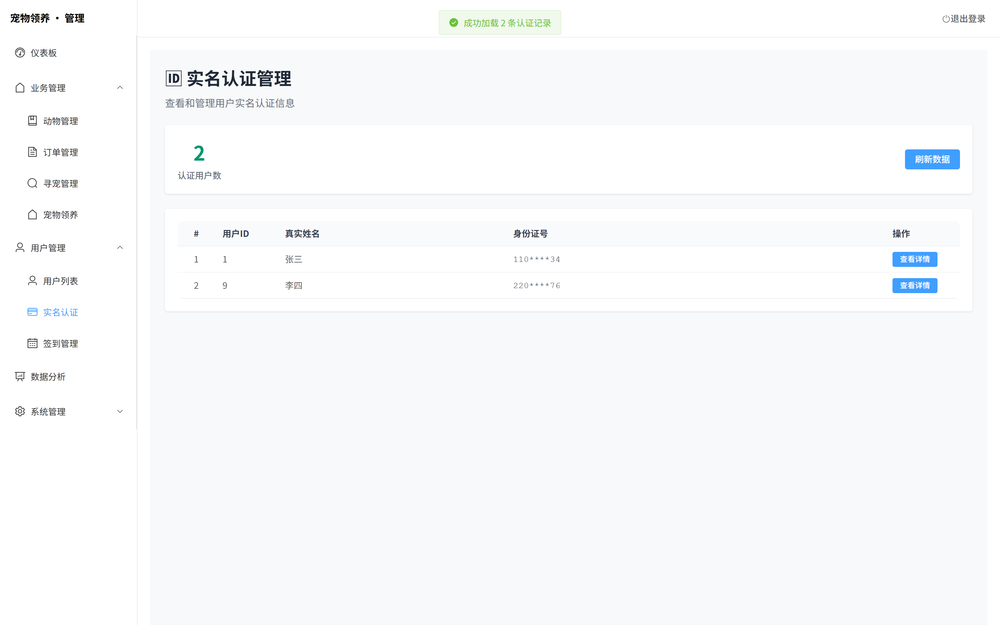

实名认证管理展示认证用户数与脱敏后的身份证号，现有 2 条记录。

**运营管理**

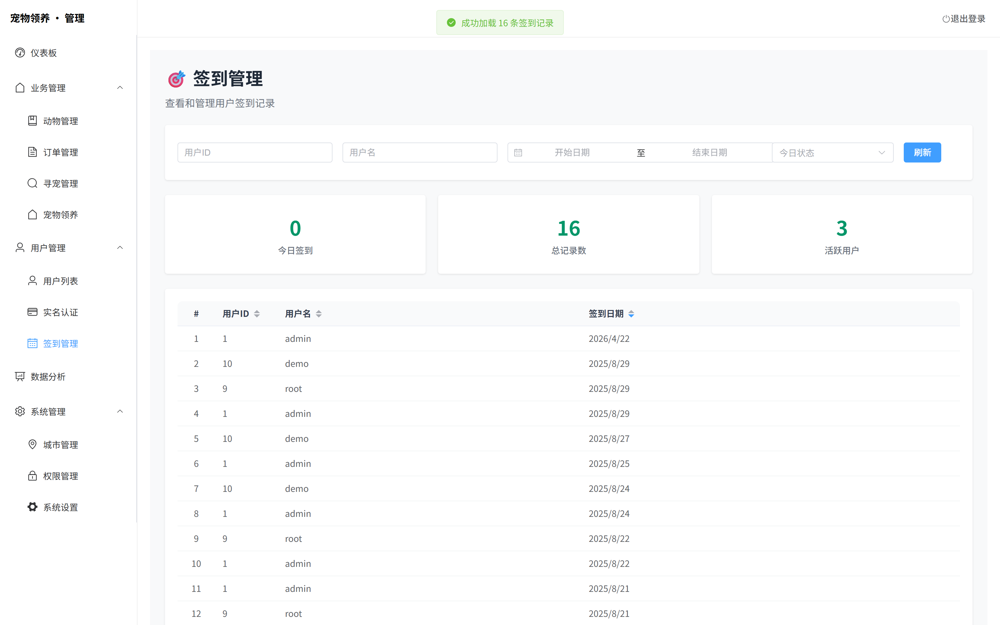

签到管理顶部为今日签到、总记录数、活跃用户三项指标，下方为可按用户与日期筛选的签到流水，现有 16 条记录。

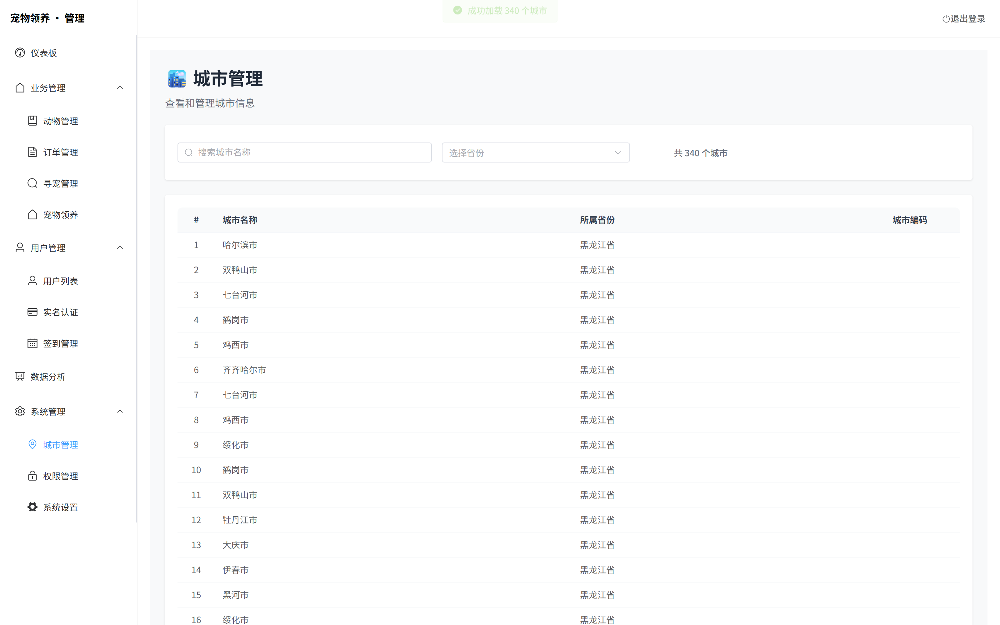

城市管理维护 340 个城市，按省份归类并附带城市编码，支持按名称与省份筛选。该页数据量对应 `pet_collar.sql` 中一千三百余条 INSERT 语句。

**数据分析**

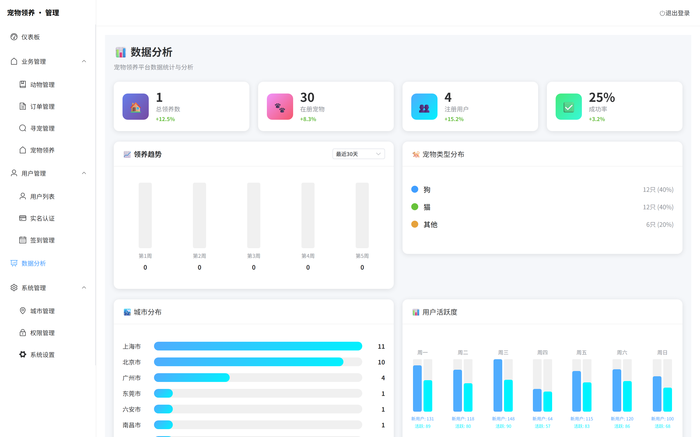

数据分析使用 ECharts 绘制四张图表：领养趋势柱状图、宠物类型分布、城市分布条形图、用户活跃度分组柱状图，顶部为在册宠物 30、注册用户 4、成功率 25% 三项指标。其中领养趋势图当前无数据，按周聚合结果均为 0。

**系统管理**

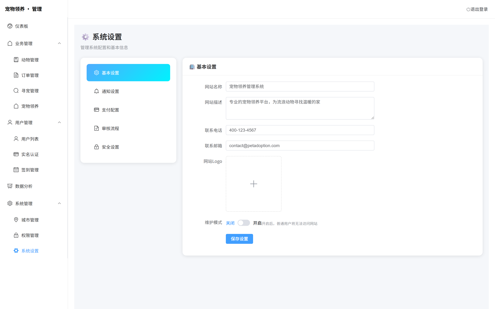

系统设置包含站点名称、描述、客服电话与邮箱、Logo 以及维护模式开关。该页为纯前端表单，未对接接口。

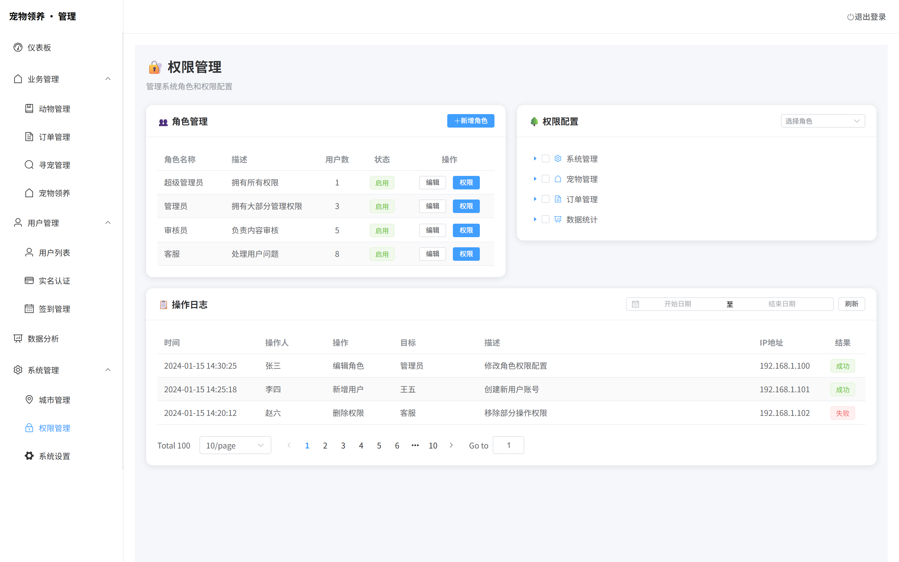

权限管理左侧为角色表（超级管理员、管理员、审核员、客服，含用户数与状态），右侧为权限树，下方为操作日志。当前为演示数据。

后台各页面的数据来源汇总如下：

| 数据来自 MySQL | 静态或演示数据 |
| --- | --- |
| 动物、订单、寻宠、已领养、用户、实名、签到、城市、数据分析 | 仪表盘指标卡、权限管理、系统设置 |

## 六、后端服务与数据库

### 两套服务并存

仓库中存在两份后端实现：

- `backend/`：仅服务项圈模块的独立服务，1184 行、4 个 controller、使用内存 H2 数据库，启动无需额外配置，适合单独调试项圈接口。
- `SpringBoot/`：与领养业务合并的全量服务，78 个 Java 文件，连接 MySQL，项圈相关接口位于 `com.example.springboot.petcare` 包内。

移动端与管理后台均请求 8080 端口，实际部署使用后者，下文描述亦以其为准。

### 接口分组

| 分组 | 端点 | 说明 |
| --- | --- | --- |
| 设备 | `GET /api/pet-care/devices`、`/devices/{id}`、`/devices/by-user/{userId}` | 设备列表与详情 |
| 绑定 | `POST /api/pet-care/devices/bind`、`/devices/{id}/share` | 绑定设备、家庭共享 |
| 体征 | `GET /devices/{id}/vitals/recent`、`/vitals`、`/vitals/trend?range=24h\|7d` | 最近采样、区间采样、趋势 |
| 告警 | `GET /devices/{id}/alerts`、`/alerts/recent`、`POST /alerts/{id}/read` | 告警列表与已读标记 |
| 档案 | `GET /devices/{id}/archive/summary`、`POST /devices/{id}/archive/generate` | 档案摘要与报告生成 |
| 位置 | `GET /devices/{id}/location/latest` | 最新位置、距离、安全区判定 |
| 设置 | `GET /users/{id}/settings`、`PUT /users/{id}/settings` | 阈值读取与保存 |

### 数据表

```
pet_device       设备（序列号、宠物名、品种、年龄、固件版本、电量、最后在线）
vital_sample     体征采样（心率、体温、活动量、采样时间）
alert_record     告警记录（类型、级别、消息、已读、位置摘要）
location_ping    位置点（经纬度、RSSI、时间）
user_settings    用户级阈值
device_settings  设备级阈值
```

其余二十余张表属于领养业务：省市区、宠物、订单、签到、收藏、实名认证。`pet_collar.sql` 两千余行，其中一千三百余条为省市字典数据，手写表结构不足一百行，字典数据在总量中占比较高。

### 启动方式

```bash
# 后端（JDK 17 + MySQL 8，数据库 pet_adoption）
cd SpringBoot && mvn spring-boot:run

# 前端
cd vue && npm install && npm run dev     # http://localhost:5173
```

接口实测结果：

```bash
curl http://127.0.0.1:8080/api/pet-care/devices
# {"success":true,"data":[{"deviceSn":"MHZ-DEMO-001","petName":"豆豆",...}]}

curl http://127.0.0.1:8080/api/pet-care/devices/1/location/latest
# {"approximateDistanceMeters":81.92231118140296,"safeRadiusMeters":100.0,"isWithinSafeRadius":true}
```

上一节关于距离由固定坐标计算得出的结论即来自此处：接口返回 81.92 米，与移动端截图中的「约 82 米」一致。

### 健康档案摘要接口

给定设备与时间段，后端完成平均值与告警次数统计后，直接返回一段自然语言摘要：

> 统计时段内共采集 128 条生理数据，平均心率约 96 BPM，平均体温约 38.1 ℃，告警 3 次。

移动端报告页可直接渲染该字段，无需在前端拼接文案，也避免了无数据时句式不完整的问题。

## 七、关键技术实现

### 1. 基于 ArkTS 实现 MQTT 3.1.1 客户端

ArkTS 提供的网络能力包括 `@ohos.net.socket`（裸 TCP/UDP）与 `@ohos.net.http`（HTTP 请求），未提供 MQTT 客户端。npm 上的 `mqtt.js` 依赖 Node 的 `net` 与 `Buffer` 模块，在 ArkTS 编译阶段即无法通过。

替代方案同样受限：IoTDA 设备侧仅提供 MQTT / CoAP 接入，属性上报无法通过 HTTP 轮询获取；由后端中转是更合理的架构，但当时不具备公网服务器条件。

因此按协议自行实现。MQTT 3.1.1 报文分为三段：

```
固定头 (1 字节)   → 高 4 位报文类型，低 4 位标志
剩余长度 (1~4 字节) → base-128 变长编码
可变头 + 载荷
```

其中「剩余长度」最易出错：每个字节仅低 7 位存放数据，最高位作为后续字节标志，且低位在前。

```ts
function encodeRemainingLength(length: number): Uint8Array {
  const bytes: number[] = [];
  let remaining = length;
  do {
    let byte = remaining % 128;
    remaining = Math.floor(remaining / 128);
    if (remaining > 0) byte |= 0x80;
    bytes.push(byte);
  } while (remaining > 0);
  return new Uint8Array(bytes);
}
```

认证环节比报文格式更复杂。IoTDA 的要求为：

- `clientId` = `设备ID_时间戳`（秒级）
- `password` = `Base64( HMAC-SHA256(设备密钥, 同一个时间戳) )`

两处时间戳必须完全一致。若构造 `clientId` 与计算密码分别取时，跨过一个整秒即会导致密码错误，Broker 返回码 4（用户名或密码错误）。该错误并非稳定复现，容易被误判为网络问题。

计算 HMAC 需要 SHA-256。ArkTS 的 `@ohos.security.cryptoFramework` 采用 Cipher / Sign / Mac 的异步接口组织，为实现单个 HMAC 而构造密钥对象与回调链路，复杂度高于自行实现。因此按 FIPS 180-4 实现 SHA-256（64 个轮常量、8 个初始哈希值、64 轮压缩），连同 HMAC 与 Base64 共约一百五十行。需注意每轮累加后须补 `| 0`：JavaScript 位运算按 32 位有符号整数处理，缺少该处理会在特定输入下溢出为浮点数。

第三个问题是 TCP 的流式特性。Broker 单次发送的数据可能是一个完整报文，也可能只有半个或包含多个半报文。若按「一次接收即一个报文」处理，运行中会出现无规律中断。因此接收端维护缓冲区，循环解析，数据不完整时保留待续：

```ts
let offset = 0;
while (offset < this.receiveBuf.length) {
  const result = parseMqttPacket(this.receiveBuf, offset);
  if (!result) break;              // 报文不完整，等待后续数据
  this.handlePacket(result.type, result.flags, result.payload);
  offset += 1 + rlBytesUsed + result.payload.length;
}
if (offset > 0) this.receiveBuf = this.receiveBuf.slice(offset);
```

最终 `IoTMqttService.ets` 共 830 余行，包含单例与回调注册、40 秒心跳（KeepAlive 设为 60 秒）、断线重连（初始 3 秒，每次乘以 1.5，上限 30 秒，最多 5 次）、CONNACK 六种返回码的说明，以及用于无设备场景的模拟模式：每 3 秒生成一组经纬度漂移与 55~85 的心率数据，使界面与交互逻辑可独立调试。

模拟模式将数据源抽象为可替换的回调，使「订阅、解析、状态更新、重绘」整条链路在没有硬件的情况下也能验证，对开发效率的提升较为明显。

### 2. 使用 Canvas 实现地图与图表

项目未引入图表库。实时追踪页由网格、坐标映射与手势缩放构成；健康档案页包含三张 Canvas 图表：心率折线（超出正常区间的点标红）、体温折线（正常区间填色）、活动量柱状图。报告页（860 行）将同类数据按 7 天 / 30 天聚合后绘制为三张小图，并根据异常次数生成建议文案。

该方案的优点是包体小、渲染可控、离线可用；代价是坐标轴、刻度、留白均需自行计算，样式调整时须同步修正相关常量。

## 八、已知限制

以下为本项目当前的真实状态，与设计文档中的规划分开说明：

- **项圈硬件**：开发板飞线验证通过；PCB 完成原理图，未打样。
- **数据上报**：MQTT 链路连通；端口 1883 为明文，未启用 TLS 与双向认证。
- **设备密钥**：硬编码，移动端常量与 `application.properties` 各存一份。
- **心率采集**：器件可用但未标定，缺少标准心率源对比，绝对精度未验证。
- **体温**：未实现，MLX90614 未接入硬件，数值为模拟公式。
- **告警**：仅演示数据，三条固定记录，无规则引擎，`alert_record` 表为空。
- **阈值设置**：仅界面，GET 返回固定默认值，PUT 直接返回 true，不落库亦不参与判断。
- **定位地图**：Canvas 模拟，无路网与地名词条。
- **消息推送**：未实现，未接入华为 Push Kit。
- **时序存储**：全部使用 MySQL，设计文档中的 TDengine、Kafka、Redis 均未落地。
- **移动端**：模拟器可运行，HarmonyOS 5.0.1(13) 实测主要页面均可操作。
- **健康趋势页**：图表为空，`/vitals/trend` 当前返回空数组，仅绘制坐标轴。
- **后端部署**：两套服务并存，`backend/` 与 `SpringBoot/` 未合并。

设计文档共十一个章节，包含 C4 架构图、ADR 决策记录、API 契约与非功能指标，其中相当一部分描述的是产品的完整形态，而非当前实现。两者需要分别表述。

## 九、结语

本项目是本人第一次完整实现「嵌入式、云平台、后端服务、双端界面」的整条链路。

此前开发前后端时，数据均由程序生成，取值与展示完全可控。本项目中，数据的真实来源是一块 160MHz 的芯片：信号条件不足时数据无法到达，传感器贴合不良时心率波形失真，GPS 在室内无法定位且等待时间无法缩短。演示阶段使用的模拟数据已在前面各节标注，但硬件调试阶段遇到的问题均为实际经历。

其中较具体的一点是：**硬件问题无法通过日志定位**。代码错误可以修改，而天线布局不当、地平面处理不完整、电池电压降至 3.2V 以下导致 LDO 输出不稳，这些问题需要借助万用表测量才能确认。

整个开发过程中修改最多的部分不是界面，而是「数据为何未上报」。该问题的原因分布在五个环节，且每一环节都可能产生误导：云端显示设备离线，可能源于 Wi-Fi 未连接、MQTT 认证失败、报文粘包解析异常，也可能仅仅是电池电量耗尽。逐一排除这些可能性的过程，其收获大于完成两万行 ArkTS 代码本身。
